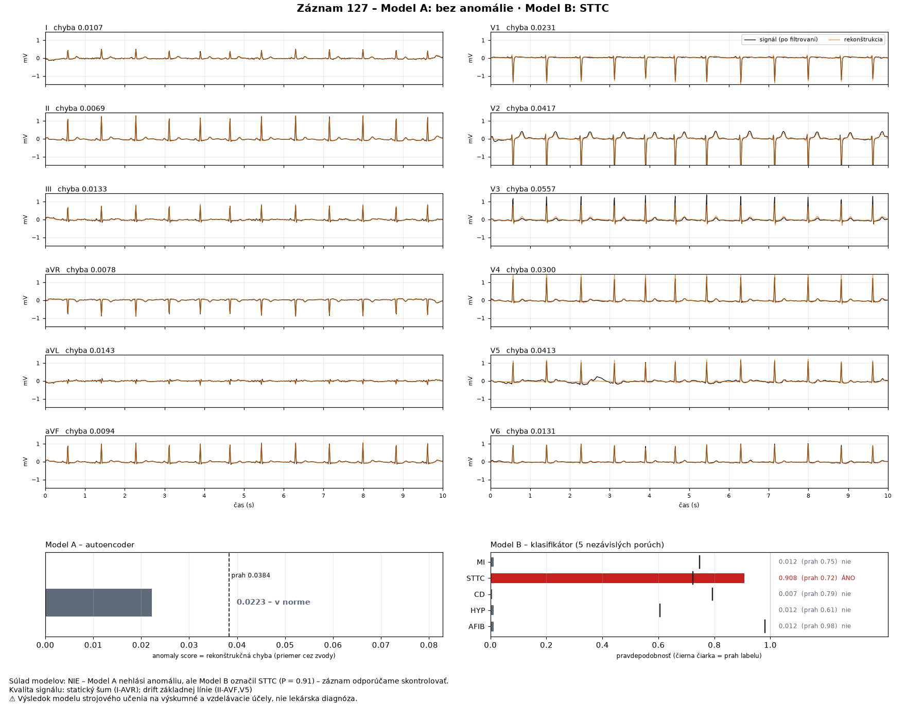

# Detekcia anomálií a klasifikácia EKG

Maturitný projekt – Matúš Nosko, IV.C, SPŠE Zochova 9 Bratislava (odbor umelá inteligencia).

Systém umelej inteligencie na analýzu 10-sekundového **12-zvodového EKG** (PTB-XL, 100 Hz) dvoma modelmi:

- **Model A – 1D konvolučný autoencoder** trénovaný iba na normálnych záznamoch. Vypočíta
  **anomaly score** = rekonštrukčnú chybu; záznam je anomália, ak score ≥ prah nastavený na validation.
- **Model B – multi-label klasifikátor** (1D ResNet) s piatimi nezávislými výstupmi – **pravdepodobnosť**
  porúch MI (infarkt), STTC (zmeny ST/T), CD (poruchy vedenia), HYP (hypertrofia) a AFIB (fibrilácia
  predsiení), každá s vlastným prahom z validation.

Výstup zobrazí anomaly score aj pravdepodobnosť jednotlivých porúch – v príkazovom riadku, ako obrázok
alebo vo web aplikácii.

> ⚠️ **Výskumný a vzdelávací nástroj, nie lekárska diagnostika.** Výsledky modelov nenahrádzajú
> vyšetrenie lekárom a nesmú sa použiť na rozhodovanie o pacientovi.



Plán práce: [GitHub Project](https://github.com/orgs/SPSE-Zochova-2627-4c/projects/18) ·
[issues](https://github.com/SPSE-Zochova-2627-4c/Nosko_EKG-classification/issues) ·
denník rozhodnutí vrátane neúspešných pokusov: [docs/dennik.md](docs/dennik.md)

## Výsledky (oddelená test množina)

Záverečné vyhodnotenie na test množine PTB-XL (fold 10, 2 198 záznamov od 1 904 pacientov, žiadny pacient
nie je v trénovacích ani validačných dátach). Modely, prahy, dáta aj kód boli **pred testom zmrazené**
a test prebehol jediný raz ([docs/zaverecne_vyhodnotenie.md](docs/zaverecne_vyhodnotenie.md)).
V zátvorke 95 % interval (bootstrap po pacientoch).

| Model | metrika | validation | **test** |
|---|---|---|---|
| A – autoencoder (prísny NORM vs. patológia) | AUROC | 0,832 | **0,796** (0,771 – 0,820) |
| | senzitivita / špecificita | 0,612 / 0,910 | 0,586 / 0,858 |
| B – klasifikátor (5 porúch) | macro AUROC | 0,938 | **0,929** (0,922 – 0,936) |
| | macro F1 | 0,758 | **0,745** (0,728 – 0,762) |

| porucha (test) | MI | STTC | CD | HYP | AFIB |
|---|---|---|---|---|---|
| F1 | 0,718 | 0,765 | 0,767 | 0,606 | 0,870 |
| AUROC | 0,910 | 0,933 | 0,917 | 0,903 | 0,981 |

Klasifikátor je na úrovni benchmarku PTB-XL (Strodthoff et al. 2020, macro AUROC ~0,93 pri podobnej
úlohe). Autoencoder zachytí približne 60 % patológií – hodí sa ako doplnkový signál, nie ako samostatný
detektor.

## Rýchly štart – demo bez datasetu

Demo potrebuje iba kód, dva natrénované modely (~10 MB) a 4 ukážkové záznamy, ktoré sú v repozitári
([examples/](examples/)). Celý dataset (1,8 GB) treba až na tréning a vyhodnotenie.

1. **Nainštaluj [uv](https://docs.astral.sh/uv/)** – nainštaluje správny Python (3.11) aj všetky knižnice
   presne podľa `uv.lock`:

   ```bash
   curl -LsSf https://astral.sh/uv/install.sh | sh
   ```

   Na Windows: `powershell -c "irm https://astral.sh/uv/install.ps1 | iex"`. Potom otvor nový terminál.

2. **Naklonuj repozitár a nainštaluj závislosti:**

   ```bash
   git clone https://github.com/SPSE-Zochova-2627-4c/Nosko_EKG-classification.git
   cd Nosko_EKG-classification
   uv sync
   uv run ekg-check          # na konci: „Prostredie je pripravené.“
   ```

3. **Stiahni natrénované modely** z GitHub Releases
   ([model-ae_v1](https://github.com/SPSE-Zochova-2627-4c/Nosko_EKG-classification/releases/tag/model-ae_v1),
   [model-clf_v1](https://github.com/SPSE-Zochova-2627-4c/Nosko_EKG-classification/releases/tag/model-clf_v1)):

   ```bash
   B=https://github.com/SPSE-Zochova-2627-4c/Nosko_EKG-classification/releases/download
   curl -fL --create-dirs -o checkpoints/ae_v1/best.pt          $B/model-ae_v1/best.pt
   curl -fL --create-dirs -o checkpoints/ae_v1/threshold.json   $B/model-ae_v1/threshold.json
   curl -fL --create-dirs -o checkpoints/clf_v1/best.pt         $B/model-clf_v1/best.pt
   curl -fL --create-dirs -o checkpoints/clf_v1/thresholds.json $B/model-clf_v1/thresholds.json
   uv run ekg-final-eval --check   # „Zmrazenie sedí.“ = presne tie modely, ktoré prešli testom
   ```

   Pod „Zmrazenie sedí.“ sa vypíšu aj 2 zdokumentované opravy kódu po teste (#23) – modely, prahy
   ani dáta sa po teste nezmenili ([zaverecne_vyhodnotenie.md](docs/zaverecne_vyhodnotenie.md#zmeny-po-teste)).

4. **Spusti demo** – postup aj očakávané výstupy: **[docs/demo.md](docs/demo.md)**

   ```bash
   uv run ekg-predict examples/00127_lr          # výsledok v termináli
   uv run ekg-show examples/00127_lr             # obrázok → outputs/zobrazenie/zaznam_00127_lr.png
   uv run streamlit run streamlit_app.py         # web aplikácia → http://localhost:8501
   ```

## Ako systém funguje

```
EKG záznam (12 × 1000, mV, 100 Hz)
  → kontrola vstupu (kontrakt) a kvality signálu
  → preprocessing: filter 0,5 Hz + normalizácia po zvodoch (parametre iba z train)
  ├─ Model A: autoencoder → rekonštrukcia → anomaly score (chyba) ≥ prah 0,0384 → anomália
  └─ Model B: 1D ResNet → 5 pravdepodobností (sigmoid) ≥ prah labelu → porucha
  → súlad modelov (pri nesúlade oba výsledky + upozornenie) → JSON / CSV / obrázok / web
```

| téma | rozhodnutie | dokument |
|---|---|---|
| dataset | PTB-XL v1.0.3, 21 799 záznamov od 18 869 pacientov, 100 Hz, overené SHA256 | [data/README.md](data/README.md), [prieskum_dat.md](docs/prieskum_dat.md) |
| labely | MI, STTC, CD, HYP = diagnostické supertriedy PTB-XL, AFIB = rytmický kód; likelihood sa nepoužíva (ako benchmark) | [mapovanie_labelov.md](docs/mapovanie_labelov.md) |
| výber NORM | **prísny NORM** pre autoencoder: NORM s istotou 100 %, žiadny iný nález, sínusový rytmus, bez šumu | [mapovanie_labelov.md](docs/mapovanie_labelov.md) |
| rozdelenie dát | odporúčané foldy PTB-XL: 1–8 train, 9 validation, 10 test; **po pacientoch**, test zamknutý | [rozdelenie_dat.md](docs/rozdelenie_dat.md) |
| preprocessing | hornopriepustný filter 0,5 Hz, z-score po zvodoch z train množiny | [preprocessing.md](docs/preprocessing.md) |
| kontrola kvality | plochý zvod, extrémna amplitúda, saturácia + anotácie šumu – iba varovanie | [kontrola_kvality.md](docs/kontrola_kvality.md) |
| Model A | 1D konvolučný autoencoder, 321 436 parametrov, latent 16 × 125 (6× kompresia); tréning na 3 905 záznamoch prísneho NORM | [model_a_autoencoder.md](docs/model_a_autoencoder.md), [trening_autoencodera.md](docs/trening_autoencodera.md) |
| anomaly score | priemerná kvadratická chyba rekonštrukcie cez 12 zvodov | [rekonstrukcna_chyba.md](docs/rekonstrukcna_chyba.md) |
| prah anomálie | maximum Youdenovho J na validation (prísny NORM vs. patológia) | [prah_anomalie.md](docs/prah_anomalie.md), [analyza_autoencodera.md](docs/analyza_autoencodera.md) |
| Model B | 1D ResNet, 2,18 mil. parametrov, BCE s váhami `pos_weight = neg/pos` | [model_b_klasifikator.md](docs/model_b_klasifikator.md), [trening_klasifikatora.md](docs/trening_klasifikatora.md) |
| prahy labelov | maximum F1 na validation pre každý label (kritérium určené vopred) | [prahy_labelov.md](docs/prahy_labelov.md), [vyhodnotenie_klasifikatora.md](docs/vyhodnotenie_klasifikatora.md) |
| výstup | kontrakt (schéma 1.2), export JSON / CSV, inference oboch modelov, pravidlo súladu | [kontrakt.md](docs/kontrakt.md), [export.md](docs/export.md), [inference.md](docs/inference.md) |
| zobrazenie | obrázok (12 zvodov, rekonštrukcia, výsledky) a web aplikácia | [zobrazenie.md](docs/zobrazenie.md) |
| záverečný test | zmrazenie → jediný beh na test množine | [zaverecne_vyhodnotenie.md](docs/zaverecne_vyhodnotenie.md) |

## Reprodukcia celého postupu

Potrebuje stiahnutý dataset. Tréning beží na CPU (Intel Mac: autoencoder ~27 min) alebo rýchlejšie
na GPU (AMD RX 9070 XT cez ROCm vo WSL2: klasifikátor 2,5 min) – [docs/gpu_prostredie.md](docs/gpu_prostredie.md).

```bash
# dáta
uv run ekg-download             # PTB-XL 100 Hz (ZIP 1,84 GB), overí SHA256
uv run ekg-verify-data          # načíta a overí všetkých 21 799 záznamov
uv run ekg-labels               # mapovanie labelov a prísny NORM
uv run ekg-splits --check       # overí manifest rozdelenia (manifests/splits_v1.0.csv)
uv run ekg-preprocess           # cache signálov + parametre normalizácie z train
uv run ekg-check-data           # kontrolný priechod celou dátovou pipeline
uv run ekg-quality              # kontrola kvality záznamov

# Model A
uv run ekg-train-ae             # tréning autoencodera (--resume po prerušení)
uv run ekg-calibrate-ae --rule youden   # prah anomálie na validation
uv run ekg-ae-analysis          # vyhodnotenie a analýza chýb na validation

# Model B
uv run ekg-train-clf            # tréning klasifikátora (--resume po prerušení)
uv run ekg-calibrate-clf --save # prahy labelov na validation
uv run ekg-clf-report           # vyhodnotenie a analýza chýb na validation

# celý systém
uv run ekg-predict --ecg-id 127 # inference oboch modelov (záznam PTB-XL; test množina je zamknutá)
uv run ekg-final-eval --check   # záverečný test: overí zmrazenie (výsledky už existujú, neprepíšu sa)
```

Ďalšie pomocné príkazy: `ekg-explore` (grafy datasetu), `ekg-ae-info` / `ekg-clf-info` (architektúry),
`ekg-ae-report`, `ekg-clf-compare` (porovnanie behov), `ekg-gpu-bench` (rýchlosť CPU vs. GPU).
Natrénované modely sa necommitujú – zdieľajú sa ako GitHub Release `model-<beh>`.

### PyTorch na rôznych počítačoch

| Počítač | PyTorch | Použitie |
|---|---|---|
| Intel Mac | 2.2.2, iba CPU (novšie verzie pre Intel Mac neexistujú) | písanie kódu, testy, demo |
| PC s AMD RX 9070 XT (WSL2 Ubuntu 24.04) | 2.14.0 + ROCm 10.1 iba pre gfx1201 (index AMD) | trénovanie |
| Google Colab / Kaggle | predinštalovaná verzia s CUDA ([notebook](notebooks/colab_trening.ipynb)) | záloha na trénovanie |

Na Linuxe `uv sync` nainštaluje PyTorch s ROCm z indexu AMD; Ubuntu potrebuje navyše `libgomp1`
a `libc6-dev`. Inference beží vždy na CPU vo float32 (reprodukovateľný výsledok).

## Obmedzenia

- **Jeden zdroj dát.** Modely sú trénované a testované iba na PTB-XL (jedna inštitúcia, záznamy
  z rokov 1989 – 1996). Na iných dátach (iné prístroje, populácia) môžu fungovať horšie – externá
  validácia nebola robená (#31).
- **Neisté a nevyvážené anotácie.** Labely vychádzajú z nálezov kardiológov vrátane neistých
  (napr. „infarkt nie je vylúčený“); recall MI je pri neistých anotáciách 0,58, pri istých 0,89.
  Poruchy sú nevyvážené (AFIB 7 %, HYP 12 % záznamov).
- **Iba 5 porúch.** Iné poruchy (napr. flutter, extrasystoly) Model B nepozná; autoencoder ich môže
  označiť ako anomáliu bez konkrétneho labelu.
- **Autoencoder je slabý detektor** (test AUROC 0,796, zachytí ~60 % patológií) a na teste mal viac
  falošných poplachov ako na validation.
- **Iba 100 Hz a 10 s.** Iná frekvencia alebo dĺžka sa odmietne; jemné zmeny P vlny (napr. zväčšenie
  predsiení) sú pri 100 Hz ťažko zachytiteľné.
- **Prahy** sú nastavené na F1 / Youdenov index, nie na klinicky zvolenú citlivosť.
- Výsledok **nie je diagnóza** – pozri upozornenie vyššie.

## Štruktúra repozitára

```
├── src/ekg/           # zdrojový kód (Python balík ekg)
├── tests/             # testy (pytest)
├── streamlit_app.py   # web aplikácia (demo)
├── examples/          # 4 ukážkové záznamy PTB-XL (CC BY 4.0)
├── configs/           # konfigurácie tréningu
├── manifests/         # rozdelenie dát, parametre preprocessingu, kvalita (v gite)
├── docs/              # dokumentácia, denník, výsledky (docs/vysledky/), obrázky
├── notebooks/         # Colab notebook na tréning
├── data/              # dataset – mimo gitu, pozri data/README.md
├── checkpoints/       # natrénované modely – mimo gitu, GitHub Releases
└── outputs/           # reporty a grafy z behov – mimo gitu
```

Umiestnenie dát, checkpointov a výstupov sa dá zmeniť premennými prostredia `EKG_DATA_DIR`,
`EKG_CHECKPOINT_DIR` a `EKG_OUTPUT_DIR`.

## Vývoj

```bash
uv run pytest -q -W error::UserWarning   # testy (bez datasetu a modelov sa časť preskočí)
uv run ruff check .                      # kontrola kódu
uv run ruff format .                     # formátovanie
```

## Licencie a citácie

- **Kód:** [Apache License 2.0](LICENSE), © 2026 Matúš Nosko ([NOTICE](NOTICE)).
- **Dataset PTB-XL** a ukážkové záznamy v `examples/`: [CC BY 4.0](https://creativecommons.org/licenses/by/4.0/).
  Wagner, P., Strodthoff, N., Bousseljot, R., Samek, W., & Schaeffter, T. (2022). PTB-XL, a large publicly
  available electrocardiography dataset (version 1.0.3). PhysioNet. https://doi.org/10.13026/kfzx-aw45
- **Natrénované modely** (GitHub Releases) vznikli tréningom na PTB-XL – pri ich použití uveď aj citáciu datasetu.
- Benchmark na porovnanie: Strodthoff, N., Wagner, P., Schaeffter, T., & Samek, W. (2021). Deep Learning
  for ECG Analysis: Benchmarks and Insights from PTB-XL. IEEE Journal of Biomedical and Health
  Informatics, 25(5), 1519–1528.
- Použité knižnice (PyTorch, NumPy, SciPy, pandas, scikit-learn, matplotlib, wfdb, Streamlit, …) majú
  vlastné open-source licencie (BSD, MIT, Apache 2.0); presné verzie sú v `uv.lock`.
