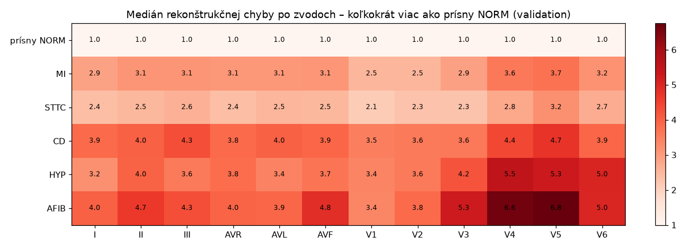
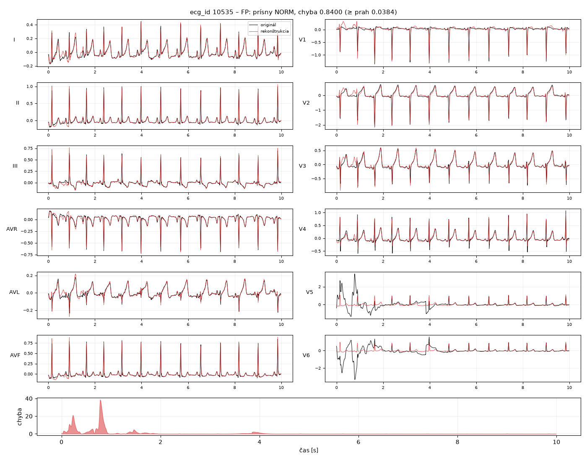
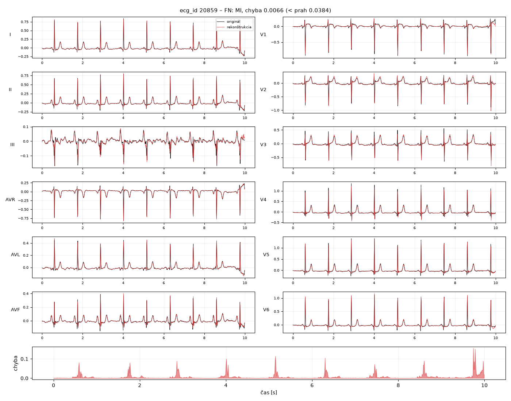
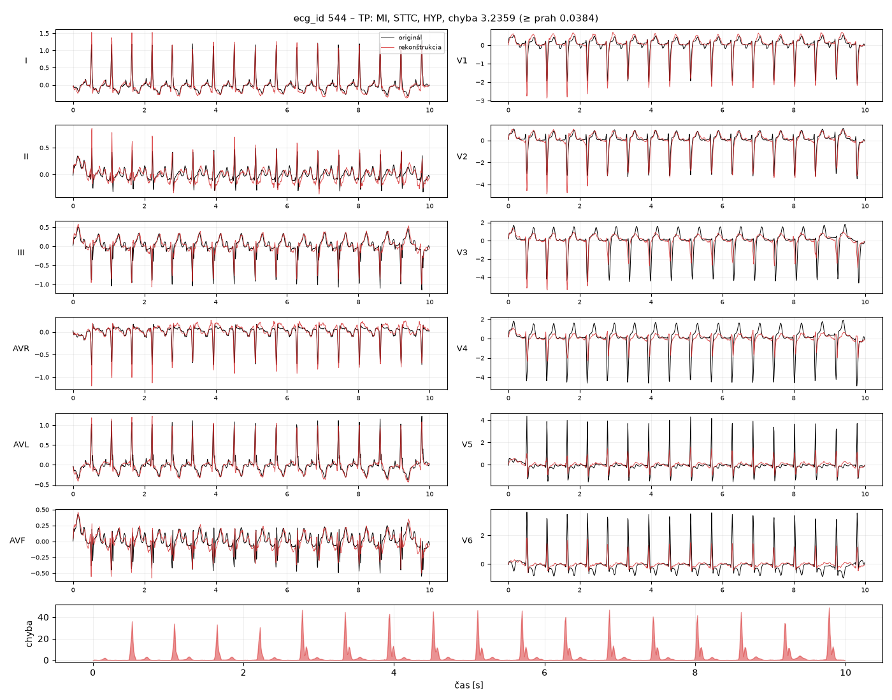

# Vyhodnotenie a analýza chýb Modelu A (beh `ae_v1`, validation)

Kód: [`src/ekg/evaluation/ae_analysis.py`](../src/ekg/evaluation/ae_analysis.py) · Spustenie: `uv run ekg-ae-analysis`
· Tabuľky: [`docs/vysledky/ae_v1/analyza/`](vysledky/ae_v1/analyza/)

Model `checkpoints/ae_v1/best.pt` (epocha 95), prah **0,03837** (Youden J, #13). Pred analýzou sa overí,
že prah patrí k checkpointu (SHA256). Všetko je **na validation**, test množina sa nepoužila.

## Celkové metriky

Referenčný cieľ: **454** prísny NORM (0) vs. **1 240** záznamov s ≥ 1 labelom (1). 489 nejednoznačných
záznamov sa do metrík nepočíta (pozri nižšie).

| | predikcia: anomália | predikcia: normálne |
|---|---|---|
| **skutočne patológia** | TP **759** | FN **481** |
| **skutočne prísny NORM** | FP **41** | TN **413** |

| senzitivita | špecificita | precision | F1 | AUROC | AUPRC |
|---|---|---|---|---|---|
| 0,612 | 0,910 | 0,949 | 0,744 | 0,832 | 0,933 |

AUPRC je vysoké aj preto, že validation obsahuje 73 % patologických záznamov. Náhodný model by mal AUPRC 0,73.
Prah bol vybraný na tej istej validation, takže metriky sú mierne optimistické. Nezávislé čísla budú v #22.

## Ktoré poruchy autoencoder zachytí?

| Label | záznamy | zachytené | medián chyby | iba tento label: záznamy | iba tento label: zachytené |
|---|---|---|---|---|---|
| MI | 540 | 66 % | 0,065 | 203 | 49 % |
| STTC | 528 | 60 % | 0,051 | 231 | **37 %** |
| CD | 495 | 74 % | 0,083 | 193 | 62 % |
| HYP | 268 | 77 % | 0,085 | 64 | 52 % |
| AFIB | 151 | **80 %** | 0,099 | 8 | 63 %* |
| 2 a viac labelov | 541 | 77 % | 0,084 | – | – |

\* iba 8 záznamov, číslo je nespoľahlivé.

- **Najlepšie** zachytí poruchy, ktoré menia **tvar QRS alebo rytmus**: AFIB (nepravidelné RR, chýbajúca P vlna),
  HYP (veľké amplitúdy) a CD (široký, deformovaný QRS pri blokádach).
- **Najhoršie** zachytí **STTC** (37 % pri samotnom STTC) a **MI** (49 %). Zmeny ST segmentu a T vlny sú
  amplitúdovo malé (desatiny mV) a pri MSE cez celý 10 s signál sa „stratia“. Starý infarkt sa často prejaví
  iba malou Q vlnou v niekoľkých zvodoch.
- Záznamy s **viacerými poruchami** sa zachytia častejšie (77 %), pretože odchýlky sa sčítajú.

## Chyby po zvodoch

- **HYP:** najväčšia chyba je v hrudných zvodoch **V4–V6** (5–5,5× NORM). To zodpovedá napäťovým kritériám
  hypertrofie ľavej komory (vysoké R vo V5, V6). Autoencoder tak veľké amplitúdy v NORM nevidel a „oreže“ ich.
- **AFIB:** najväčšia chyba je vo V3–V5 (5–7×) a v II, aVF. Nepravidelný rytmus pokazí rekonštrukciu v celom zázname.
- **MI podľa lokalizácie** (záznamy s jediným typom MI):

  | typ | záznamy | zvody s najväčšou chybou |
  |---|---|---|
  | inferiórny (IMI) | 193 | V5 2,3×, **III 2,2×**, aVL 2,1×, **II 2,1×** |
  | anteroseptálny (ASMI) | 130 | **V4 6,0×**, V5 5,4×, V6 4,5×, aVF 4,3× |

  Pri inferiórnom MI sa medzi najhoršími zvodmi objavia II a III (inferiórne zvody), pri anteroseptálnom
  prekordiálne V4–V6. Zhoda s anatómiou je však **len čiastočná** (napr. pri ASMI by sa čakalo skôr V1–V3).
  **Chyba po zvodoch preto nie je spoľahlivý ukazovateľ lokalizácie.** Na to bude lepší Grad-CAM nad klasifikátorom (#27).

## Falošné poplachy (FP = 41 z 454 prísneho NORM)

- Záznam `ecg_id 10535` má v PTB-XL označenie prísny NORM bez poznámky o šume. Napriek tomu sú **vo V5 a V6
  v prvých ~2 s zjavné artefakty elektród**. Autoencoder zachytil **skutočný problém so signálom**, len ho
  referenčné anotácie nepoznajú. Časť „falošných“ poplachov sú teda nezaznamenané artefakty (limitácia
  labelov PTB-XL, podnet pre kontrolu kvality #7).
- Najhorší zvod pri FP je najčastejšie hrudný: V1 (11×), V4 (10×), V3 (7×). Hrudné elektródy sú náchylnejšie na
  zlý kontakt.
- Medzi FP je viac mužov (68 % vs. 53 % medzi TN). Muži majú v priemere vyššie amplitúdy QRS. Vek sa nelíši
  (medián 51 vs. 52 rokov).

## Prehliadnuté patológie (FN = 481 z 1 240)

- Prehliadnuté labely: STTC 212, MI 181, CD 130, HYP 63, AFIB 30.
- Príklad `ecg_id 20859` (MI, chyba 0,0066 = 6× pod prahom): EKG vyzerá na pohľad normálne a rekonštrukcia
  je takmer dokonalá. Takúto jemnú zmenu **autoencoder z princípu nemôže** zachytiť. Naučil sa normálny tvar
  a toto EKG sa od neho takmer nelíši.

## Správne zachytená anomália (TP)

`ecg_id 544` (MI + STTC + HYP, chyba 3,24 = 84× nad prahom): QRS komplexy vo V4–V6 dosahujú 4–5 mV,
autoencoder ich zrekonštruuje iba na ~1–2 mV. Je to presne princíp detekcie: čo sa nepodobá na naučené
normálne EKG, nedá sa dobre zrekonštruovať.

## Vynechané záznamy (mimo referenčného cieľa)

| Dôvod, prečo nie je prísny NORM | záznamy | označené ako anomália | medián chyby |
|---|---|---|---|
| NORM s likelihood < 100 alebo bez diagnostického kódu | 253 | 36 % | 0,029 |
| šum / problém s elektródami | 106 | 18 % | 0,025 |
| baseline drift, extra beats, kardiostimulátor | 53 | 23 % | 0,023 |
| form kód (PVC, nízka voltáž …) | 47 | 17 % | 0,020 |
| rytmus iný ako SR | 30 | 27 % | 0,025 |

Tieto skupiny ležia medzi NORM (9 % poplachov) a patológiou (61 %), čo dáva zmysel. Zaujímavé je, že záznamy
s poznámkou o **šume** sú označené ako anomália iba v 18 %. Filter 0,5 Hz (#8) a MSE zrejme bežný šum dobre znášajú.

## Záver pre prácu

1. Autoencoder trénovaný **iba na normálnych EKG** rozlišuje normálne a patologické s AUROC 0,83.
2. Funguje dobre na poruchy **tvaru QRS a rytmu**, slabo na **ST/T zmeny a starý infarkt**.
   Preto je v systéme aj klasifikátor (Model B), ktorý sa konkrétne poruchy učí priamo.
3. Časť falošných poplachov sú **nezaznamenané artefakty**: model je citlivý aj na kvalitu signálu.
4. Chyba po zvodoch čiastočne zodpovedá anatómii (HYP vo V4–V6), ale na lokalizáciu nestačí.
