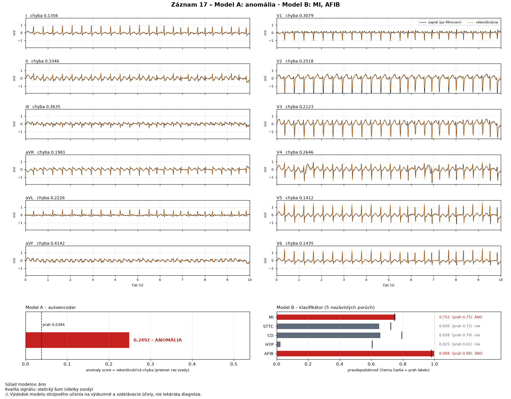

# Demo – scenár s očakávaným výstupom (issue #23)

Demo ukazuje celý systém na **4 ukážkových záznamoch** v [`examples/`](../examples/) (pôvodné záznamy
PTB-XL z validation, CC BY 4.0). **Nepotrebuje dataset**, iba nainštalované prostredie a stiahnuté
modely – postup v [README](../README.md#rýchly-štart--demo-bez-datasetu) (kroky 1–3).

> ⚠️ Výsledky sú výstupom modelov strojového učenia na výskumné a vzdelávacie účely, **nie lekárska
> diagnóza**. Aplikácia aj každý výstup to uvádzajú.

## 0. Kontrola pred demom

```bash
uv run ekg-check            # … „Prostredie je pripravené.“
uv run ekg-final-eval --check
```

Očakávané: `Zmrazenie sedí.` – stiahnuté modely a prahy sú presne tie, ktoré prešli záverečným testom.
Pod tým sa vypíšu 2 zdokumentované zmeny kódu po teste (oprava `ekg-predict` bez datasetu a samotná
kontrola) – [zaverecne_vyhodnotenie.md](zaverecne_vyhodnotenie.md#zmeny-po-teste).

## 1. Výsledok v termináli – záznam 127 (nesúlad modelov)

```bash
uv run ekg-predict examples/00127_lr
```

Očakávaný výstup:

```
Záznam 00127_lr
  anomaly score 0.0223 (prah 0.0384) → v norme
  MI    P = 0.012 (prah 0.746) nie
  STTC  P = 0.908 (prah 0.724) ÁNO
  CD    P = 0.007 (prah 0.792) nie
  HYP   P = 0.012 (prah 0.606) nie
  AFIB  P = 0.012 (prah 0.981) nie
  súlad modelov: NIE
    Model A nehlási anomáliu, ale Model B označil STTC (P = 0.91) – záznam odporúčame skontrolovať.
  Výsledok modelu strojového učenia na výskumné a vzdelávacie účely, nie lekárska diagnóza.
```

Záznam má podľa kardiológa poruchu STTC. Klasifikátor ju nájde s pravdepodobnosťou 0,91, autoencoder
nie (anomaly score 0,0223 je pod prahom 0,0384) → systém upozorní na nesúlad a ukáže oba výsledky.

## 2. Všetky 4 ukážky naraz + export

```bash
uv run ekg-predict examples/00010_lr examples/00017_lr examples/00127_lr examples/00352_lr \
    --json vysledky.json --csv vysledky.csv
```

| záznam | skutočnosť | anomaly score (prah 0,0384) | Model B (P ≥ prah) | súlad |
|---|---|---|---|---|
| 00010_lr | NORM | 0,0086 – v norme | nič | áno |
| 00017_lr | AFIB | 0,2492 – **anomália** | AFIB 0,998, MI 0,752 (falošne) | áno |
| 00127_lr | STTC | 0,0223 – v norme | STTC 0,908 | **nie** |
| 00352_lr | NORM | 0,0777 – **anomália** | nič | **nie** (falošný poplach autoencodera) |

`vysledky.json` a `vysledky.csv` obsahujú kompletný výstup podľa [kontraktu](kontrakt.md) (schéma 1.2) –
anomaly score, chyby po zvodoch, 5 pravdepodobností s prahmi, súlad, kvalitu, verzie modelov a upozornenie.

Ukážky sú vybrané tak, aby pokryli všetky 4 prípady pravidla súladu modelov (#19) – vrátane chýb:
záznam 17 dostane falošne aj MI (P 0,752 tesne nad prahom 0,746), záznam 352 je normálny, ale
autoencoder ho označí ako anomáliu.

> Rovnaké záznamy cez `--ecg-id 10` (s datasetom) dajú rovnaké pravdepodobnosti a anomaly score;
> navyše doplnia vek, pohlavie a anotácie šumu z databázy PTB-XL do poľa `quality`.

## 3. Obrázok – EKG, rekonštrukcia a výsledky

```bash
uv run ekg-show examples/00017_lr
```

Uloží `outputs/zobrazenie/zaznam_00017_lr.png`: 12 pomenovaných zvodov (os 0–10 s, mV), čierny signál,
oranžová rekonštrukcia autoencodera, chyba každého zvodu, anomaly score s prahom, 5 pravdepodobností
s prahmi a upozornenie. Popis obrázka: [zobrazenie.md](zobrazenie.md).



Pri AFIB sú dobre vidieť nepravidelné rozostupy QRS komplexov; anomaly score 0,249 je 6,5× nad prahom.

## 4. Web aplikácia

```bash
uv run streamlit run streamlit_app.py
```

Otvor http://localhost:8501.

1. **Zdroj „Ukážka“** (predvolený) → záznam *10 – NORM*: anomaly score 0,0086, „v norme“, žiadna porucha,
   súlad modelov áno.
2. Vyber **127 – STTC** → žltý rámček „Modely nesúhlasia“, v tabuľke STTC 0,908 „pozitívny“ (červený pruh).
3. Vypni **„Zobraziť rekonštrukciu autoencodera“** → na obrázku ostane iba signál.
4. Tlačidlami **Výsledok JSON / CSV / Obrázok PNG** sa výsledok stiahne.
5. **Neplatný vstup:** zdroj „Vlastný súbor“ → nahraj iba `examples/00127_lr.hea` (bez `.dat`) →
   červená chyba „WFDB záznam potrebuje práve jeden súbor .hea a jeden .dat“; analýza sa nespustí.
   Nahraj `00127_lr.hea` aj `00127_lr.dat` → rovnaký výsledok ako v kroku 2.
6. (S datasetom) zdroj **„PTB-XL“** → ľubovoľné `ecg_id`; napr. **9** → „Záznam nie je dostupný – patrí
   do test množiny, ktorá je zamknutá“.

## Ako sa overilo, že demo funguje

- Výstupy v tomto dokumente sú skopírované zo skutočného behu; testy kontrolujú, že ukážkové súbory sú
  pôvodné záznamy PTB-XL (SHA256 podľa oficiálneho `SHA256SUMS.txt`) a že aplikácia ukáže rovnaké hodnoty
  ako pipeline (`tests/test_visualization.py`).
- Celý postup z README (čerstvý `git clone`, `uv sync`, stiahnutie modelov cez `curl`, kroky 0–2,
  spustenie aplikácie) bol vyskúšaný v novom priečinku bez datasetu – pozri denník (#23).
