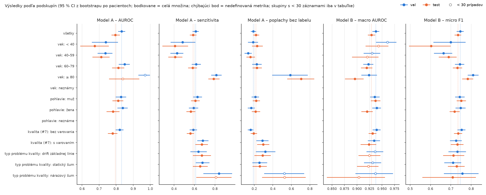

# Výsledky podľa veku, pohlavia a kvality signálu (issue #26)

Ako dobre fungujú oba modely v rôznych skupinách pacientov a záznamov? Ide o **opisnú analýzu
zmrazených modelov a prahov z #22**. Nič sa tu neladí, modely ani prahy sa nemenia.
Skript pred spustením overí, že sa od zmrazenia nezmenili modely, prahy, manifesty ani mapovanie labelov.

```bash
uv run ekg-subgroups            # ~40 s (validation inferencia na CPU + 1000× bootstrap)
```

Výstupy sú v [`docs/vysledky/podskupiny/`](vysledky/podskupiny/), graf
[`podskupiny.png`](vysledky/podskupiny/podskupiny.png).

## Dáta a zásady

| | validation | test |
|---|---|---|
| zdroj predikcií | zmrazená pipeline #19 (CPU, po jednom zázname) | **uložené predikcie z #22** – nič sa znova nepočíta |
| záznamov / pacientov | 2 183 / 1 942 | 2 198 / 1 904 |

- **Test množina:** použité sú iba predikcie, ktoré uložil jediný beh v #22. Z test množiny sa načítajú
  len labely a `patient_id`. Skript overí, že záznamy sedia s uloženými predikciami. Model sa na test
  množine nespúšťa a z výsledkov sa nič spätne neladí (rozhodol Matúš).
  Kontrola v testoch: `test_test_set_is_evaluated_only_in_final_evaluation`.
- **Skupiny sú dané vopred, bez pohľadu na výsledky:**
  - **vek:** < 40, 40 – 59, 60 – 79, ≥ 80 (rovnaké ako v #18). Vek nad 89 rokov je v PTB-XL anonymizovaný
    (val 42, test 34 záznamov) a patrí do ≥ 80.
  - **pohlavie:** muž, žena.
  - **kvalita:** výsledok kontroly kvality #7 (bez varovania / s varovaním) a typ problému.
- **Chýbajúce údaje majú vlastnú skupinu** („vek: neznámy“, „pohlavie: neznáme“). Je v reporte vždy,
  aj keď je prázdna. Vo validation ani v teste nechýba vek ani pohlavie pri žiadnom zázname, takže obe skupiny majú 0 záznamov.
- **Typy problémov kvality sa prekrývajú.** Jeden záznam môže mať napr. statický šum aj drift naraz.
- **Neistota:** 95 % interval z bootstrapu **po pacientoch** (1000 opakovaní, rovnaký postup ako #22).
- **Stav každej metriky** (stĺpce `stav` a `dôvod` v `metriky.csv`):
  - **nedefinovaná:** chýbajú potrebné prípady. Hodnota je prázdna a uvedený je dôvod, napr.
    „0 prísnych NORM“.
  - **malá skupina:** menej ako 30 potrebných prípadov (rovnaká hranica ako fallback v #17). Hodnota je
    uvedená, ale nedá sa z nej robiť záver. V tabuľkách je označená `*`, v grafe prázdnym krúžkom.
  - Pri macro metrikách rozhoduje label s najmenším počtom prípadov. Macro sa počíta, iba ak sú
    definované všetky 4–5 labelov. Priemer cez menej labelov by sa nedal porovnať s celkom.

### Prečo pri šume nie je AUROC Modelu A

Referencia pre Model A je **prísny NORM vs. patológia** (#13). Prísny NORM podľa definície vylučuje
záznamy so šumom ([mapovanie_labelov.md](mapovanie_labelov.md)). Skupina „s varovaním“ preto nemá
ani jeden prísny NORM, a AUROC ani špecificita sa v nej nedajú spočítať (stav „nedefinovaná“).

Aby sa dalo povedať aspoň niečo o falošných poplachoch, pridal som metriku **„poplachy bez labelu“**:
podiel záznamov bez akéhokoľvek z 5 labelov, ktoré Model A označí ako anomáliu. Nie je to špecificita.
Tieto záznamy zahŕňajú aj NORM s neistou anotáciou a poruchy mimo 5 labelov, takže časť týchto
„poplachov“ môže byť oprávnená. Na porovnanie skupín medzi sebou však stačí.

## Veľkosti skupín

Z [`velkosti_skupin.csv`](vysledky/podskupiny/velkosti_skupin.csv) (val / test):

| skupina | záznamov | pacientov | prísny NORM | patológia | MI | STTC | CD | HYP | AFIB |
|---|---|---|---|---|---|---|---|---|---|
| < 40 | 284 / 284 | 278 / 266 | 110 / 110 | 64 / 66 | 9 / 7 | 18 / 20 | 30 / 37 | 16 / 10 | **2 / 1** |
| 40 – 59 | 669 / 641 | 586 / 552 | 212 / 187 | 263 / 268 | 95 / 113 | 110 / 98 | 85 / 104 | 51 / 43 | 8 / 14 |
| 60 – 79 | 932 / 933 | 834 / 817 | 130 / 163 | 649 / 617 | 309 / 279 | 281 / 260 | 254 / 220 | 137 / 149 | 68 / 67 |
| ≥ 80 | 298 / 340 | 249 / 274 | **2 / 4** | 264 / 306 | 127 / 151 | 119 / 143 | 126 / 135 | 64 / 60 | 73 / 70 |
| muž | 1 133 / 1 132 | 1 003 / 969 | 245 / 253 | 653 / 629 | 310 / 297 | 244 / 229 | 265 / 266 | 159 / 135 | 72 / 81 |
| žena | 1 050 / 1 066 | 939 / 935 | 209 / 211 | 587 / 628 | 230 / 253 | 284 / 292 | 230 / 230 | 109 / 127 | 79 / 71 |
| bez varovania | 1 639 / 1 670 | 1 502 / 1 499 | 454 / 464 | 919 / 956 | 395 / 408 | 392 / 410 | 373 / 375 | 210 / 207 | 115 / 109 |
| s varovaním | 544 / 528 | 505 / 490 | **0 / 0** | 321 / 301 | 145 / 142 | 136 / 111 | 122 / 121 | 58 / 55 | 36 / 43 |
| – drift základnej línie | 229 / 236 | 220 / 231 | 0 / 0 | 141 / 122 | 63 / 59 | 62 / 48 | 59 / 48 | 26 / 27 | 14 / 13 |
| – statický šum | 331 / 316 | 305 / 292 | 0 / 0 | 186 / 189 | 79 / 88 | 80 / 68 | 64 / 75 | 32 / 30 | 22 / 28 |
| – nárazový šum | 52 / 40 | 49 / 40 | 0 / 0 | 31 / 21 | 16 / 10 | 9 / 11 | 14 / 9 | 6 / 3 | 5 / 4 |
| – problém s elektródami | 4 / 3 | 4 / 3 | 0 / 0 | 3 / 2 | | | | | |
| – problém zo signálu | 2 / 2 | 2 / 2 | 0 / 0 | 2 / 1 | | | | | |

Labely MI – AFIB sú počty v podmnožine Modelu B. Skupiny „problém s elektródami“ a „problém zo
signálu“ majú 2 – 4 záznamy, sú **nehodnotiteľné** a v grafe nie sú. Hodnoty sú iba v tabuľkách.

## Výsledky



Hodnota (95 % CI), `*` = malá skupina, – = nedefinovaná. Celý prehľad je v
[`prehlad.csv`](vysledky/podskupiny/prehlad.csv), všetky metriky po labeloch v
[`metriky.csv`](vysledky/podskupiny/metriky.csv).

### Model A (autoencoder)

| skupina | AUROC val | AUROC test | senzitivita val / test | poplachy bez labelu val | poplachy bez labelu test |
|---|---|---|---|---|---|
| všetky | 0,832 (0,813 – 0,852) | 0,796 (0,774 – 0,819) | 0,612 / 0,586 | 0,190 (0,164 – 0,216) | 0,218 (0,190 – 0,249) |
| < 40 | 0,739 (0,659 – 0,808) | 0,675 (0,591 – 0,755) | 0,484 / 0,409 | 0,186 (0,134 – 0,237) | 0,229 (0,176 – 0,288) |
| 40 – 59 | 0,737 (0,693 – 0,776) | 0,713 (0,662 – 0,759) | 0,430 / 0,410 | 0,133 (0,097 – 0,170) | 0,158 (0,118 – 0,204) |
| 60 – 79 | 0,850 (0,817 – 0,878) | 0,813 (0,777 – 0,845) | 0,616 / 0,582 | 0,226 (0,179 – 0,275) | 0,228 (0,184 – 0,277) |
| ≥ 80 | 0,970 * | 0,839 * | 0,814 / 0,788 | **0,588 (0,394 – 0,774)** | **0,706 (0,558 – 0,844)** |
| muž | 0,829 (0,798 – 0,857) | 0,812 (0,780 – 0,840) | 0,629 / 0,609 | 0,212 | 0,221 |
| žena | 0,838 (0,808 – 0,865) | 0,782 (0,745 – 0,817) | 0,593 / 0,564 | 0,166 | 0,215 |
| bez varovania | 0,820 (0,798 – 0,841) | 0,780 (0,753 – 0,805) | 0,588 / 0,560 | 0,160 (0,132 – 0,187) | 0,193 (0,162 – 0,227) |
| s varovaním | – | – | 0,682 / 0,671 | **0,287 (0,225 – 0,350)** | **0,295 (0,232 – 0,358)** |
| – drift | – | – | 0,638 / 0,672 | 0,318 | 0,289 |
| – statický šum | – | – | 0,677 / 0,656 | 0,255 | 0,260 |
| – nárazový šum | – | – | 0,839 / 0,810 * | 0,524 * | 0,526 * |

### Model B (klasifikátor)

| skupina | macro AUROC val | macro AUROC test | micro F1 val | micro F1 test |
|---|---|---|---|---|
| všetky | 0,938 (0,931 – 0,944) | 0,929 (0,922 – 0,936) | 0,746 (0,730 – 0,761) | 0,735 (0,719 – 0,750) |
| < 40 | 0,961 * | 0,943 * | 0,700 (0,615 – 0,771) | 0,603 (0,495 – 0,697) |
| 40 – 59 | 0,930 * | 0,920 * | 0,664 (0,618 – 0,705) | 0,690 (0,642 – 0,727) |
| 60 – 79 | 0,923 (0,913 – 0,932) | 0,920 (0,908 – 0,930) | 0,744 (0,721 – 0,764) | 0,733 (0,711 – 0,754) |
| ≥ 80 | 0,924 (0,909 – 0,939) | 0,896 (0,876 – 0,913) | 0,810 (0,784 – 0,835) | 0,783 (0,757 – 0,808) |
| muž | 0,935 (0,927 – 0,945) | 0,937 (0,928 – 0,946) | 0,744 (0,722 – 0,766) | 0,751 (0,729 – 0,773) |
| žena | 0,940 (0,931 – 0,947) | 0,920 (0,909 – 0,931) | 0,749 (0,724 – 0,771) | 0,718 (0,695 – 0,742) |
| bez varovania | 0,939 (0,932 – 0,947) | 0,931 (0,924 – 0,938) | 0,753 (0,734 – 0,770) | 0,736 (0,717 – 0,754) |
| s varovaním | 0,934 (0,922 – 0,945) | 0,924 (0,908 – 0,938) | 0,726 (0,697 – 0,752) | 0,732 (0,701 – 0,761) |

Macro AUROC pri < 40 a 40 – 59 je „malá skupina“, lebo AFIB tam má iba 1 – 14 prípadov.
Macro F1 v týchto skupinách (test < 40: 0,431) je z rovnakého dôvodu nespoľahlivé (AFIB 1, MI 7
prípadov). Na porovnanie je preto lepšie micro F1.

## Zistenia

1. **Model A silno závisí od veku.** Pri mladších pacientoch rozlišuje patológiu horšie
   (AUROC 0,68 – 0,74 pod 60 rokov vs. 0,81 – 0,85 pri 60 – 79) a zachytí menej patológií
   (senzitivita 0,41 – 0,48 vs. 0,79 – 0,81 pri ≥ 80). Pri ≥ 80 zároveň označí ako anomáliu
   **59 – 71 %** záznamov bez labelu. Vysvetlenie je v trénovacích dátach: prísny NORM v train
   množine má medián veku 53 rokov a iba 5 % záznamov ≥ 80 (celá train množina: medián 61, 12 % ≥ 80).
   Autoencoder sa naučil „normálne EKG mladšieho človeka“. EKG starších ľudí je preň nezvyčajné
   aj bez poruchy, a pri mladých sú zase patológie menej výrazné.
   Vysoké AUROC pri ≥ 80 (0,970 / 0,839) je „malá skupina“ – iba 2 a 4 prísne NORM.
2. **Šum zvyšuje poplachy Modelu A.** Záznamy s varovaním kvality majú o 50 – 80 % viac
   poplachov bez labelu (0,287 vs. 0,160 na val, 0,295 vs. 0,193 na teste). Intervaly sa neprekrývajú
   ani na jednej množine. Najviac pri nárazovom šume (~0,52, malá skupina).
   Nie je to skreslené vekom: skupiny s varovaním a bez neho majú rovnaký medián veku (52 vs.
   53 rokov, val) a poplachov pribúda v oboch vekových pásmach (< 60: 0,129 → 0,222, ≥ 60: 0,219 →
   0,429). Šum teda zvyšuje rekonštrukčnú chybu – presne to, čo varovanie kvality v #7 hlási.
   Senzitivita pri šume je vyššia (0,68 vs. 0,59) z rovnakého dôvodu, nie preto, že by model lepšie
   videl poruchu.
3. **Model B je voči šumu odolný.** Macro AUROC s varovaním a bez neho sa líši iba o 0,005 – 0,007
   a intervaly sa prekrývajú. Micro F1 je na val nižšie o 0,027, na teste prakticky rovnaké.
4. **Model B a vek:** micro F1 s vekom rastie (test 0,60 → 0,78). Hlavne preto, že starší majú viac
   porúch – F1 závisí od prevalencie. Macro AUROC je však **v každej vekovej skupine od 40 rokov
   nižšie ako na celej množine** (napr. test ≥ 80: 0,896 vs. 0,929). Najviac pri MI (0,857 vs. 0,910)
   a HYP (0,839 vs. 0,903). Časť celkového AUROC teda pochádza z toho, že model rozlišuje mladých
   a starých. Vo vnútri jednej vekovej skupiny je rozlišovanie porúch ťažšie. U starších sa poruchy
   častejšie kombinujú: zo záznamov s poruchou má viac labelov naraz 62 % pri ≥ 80, ale iba
   16 % pri < 40 (val), a kombinácie sú pre model ťažšie (#18).
5. **Pohlavie:** bez presvedčivého rozdielu. Na teste majú ženy nižšie micro F1 (0,718 vs. 0,751)
   a macro AUROC (0,920 vs. 0,937). Na validation je to naopak alebo rovnako (0,749 vs. 0,744;
   0,940 vs. 0,935) a intervaly sa prekrývajú. Pozorovanie z #22 sa teda **nepotvrdilo** ako
   systematický rozdiel.

## Obmedzenia

- **Viac porovnaní naraz:** ~700 metrík (2 množiny × 16 skupín × 22 metrík). Pri 95 % intervaloch
  niektoré „rozdiely“ vzniknú náhodou. Za zistenia som preto bral iba rozdiely, ktoré sú **na oboch
  množinách rovnakým smerom** (vek a šum pri Modeli A), nie jednotlivé hodnoty.
- **Skupiny sú závislé.** Vek, pohlavie a kvalita sa analyzujú každá zvlášť, nie spoločným modelom.
  Kontrola súvisu šumu a veku (bod 2) je urobená iba pre validation a iba v dvoch vekových pásmach.
- **„Poplachy bez labelu“ nie sú špecificita.** Záznamy bez labelu zahŕňajú aj poruchy mimo 5 labelov
  a neisté NORM (#14).
- Pri ≥ 80 nie je dosť prísneho NORM na spoľahlivé AUROC a špecificitu Modelu A.
- Analýza nič neopravuje: zistenia sú **návrhy na budúcnosť** (napr. trénovať autoencoder na NORM
  zo všetkých vekových skupín alebo prah podľa veku). Podľa pravidiel #22 sa po teste modely ani prahy
  nemenia.

## Kód a overenie

- `src/ekg/evaluation/subgroups.py` – skupiny, metriky, bootstrap, tabuľky, graf, CLI `ekg-subgroups`.
- Nový súbor v zmrazenom kóde, preto je zapísaný v
  [`zmeny_po_teste.json`](vysledky/test/zmeny_po_teste.json) (pozri
  [zaverecne_vyhodnotenie.md](zaverecne_vyhodnotenie.md#zmeny-po-teste)).
- `tests/test_subgroups.py`:
  - AUROC cez poradia = sklearn (aj pri zhodných skóre),
  - hranice vekových skupín a anonymizovaný vek, prázdne skupiny chýbajúcich údajov, prekrývanie typov
    šumu,
  - stav a dôvod nedefinovaných a malých metrík, macro iba pri všetkých labeloch,
  - bootstrap prevzorkúva celých pacientov, deterministický výsledok,
  - riadok „všetky“ na teste sa presne zhoduje s reportom #22,
  - `load_test` nespúšťa model,
  - uložené výsledky: súčty skupín = celok.
