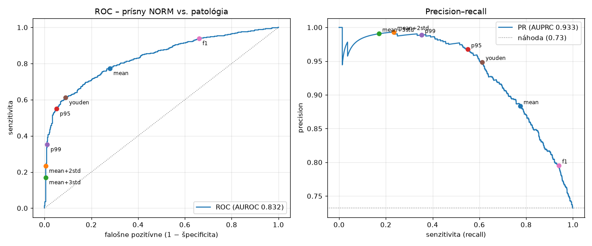

# Prah detekcie anomálií (Model A, beh `ae_v1`)

Kód: [`src/ekg/anomaly_threshold.py`](../src/ekg/anomaly_threshold.py) ·
Uložený prah: [`docs/vysledky/ae_v1/prah.json`](vysledky/ae_v1/prah.json) (kópia pri modeli v `checkpoints/ae_v1/threshold.json`)

```bash
uv run ekg-calibrate-ae                 # porovnanie pravidiel na validation
uv run ekg-calibrate-ae --rule youden   # uloženie zvoleného prahu
```

## Pravidlo rozhodovania

**Záznam je anomália, ak rekonštrukčná chyba ≥ 0,03837** (MSE, priemer cez 12 zvodov, #12).
Prah zvolený podľa **maxima Youdenovho J** na validation.

## Ako sa prah kalibroval

- **Iba na validation** (fold 9). Train chyby sú optimistické (model ich videl pri učení), test (#22) zostáva zamknutý.
- **Referenčný cieľ** podľa anotácií overených človekom (foldy 9 a 10 sú celé validované):
  0 = **prísny NORM** (454 záznamov), 1 = **aspoň jeden** z labelov MI, STTC, CD, HYP, AFIB (1 240 záznamov).
- 489 nejednoznačných záznamov (NORM so šumom alebo s form kódom, záznam bez diagnostického kódu) sa
  vynechalo, lebo pre ne nie je jednoznačné, či má byť výsledok „anomália“.

## Porovnanie pravidiel (validation, AUROC 0,832, AUPRC 0,933)

| Pravidlo | prah | senzitivita | špecificita | precision | F1 | falošné poplachy (z 454 NORM) | prehliadnuté (z 1 240) |
|---|---|---|---|---|---|---|---|
| priemer NORM (pôvodný slajd 11) | 0,0255 | 77 % | 72 % | 88 % | 0,83 | **127 (28 %)** | 280 |
| priemer + 2·std | 0,1182 | 23 % | 99,6 % | 99 % | 0,38 | 2 | 950 |
| priemer + 3·std | 0,1646 | 17 % | 99,6 % | 99 % | 0,29 | 2 | 1 029 |
| 95. percentil NORM | 0,0446 | 55 % | 95 % | 97 % | 0,70 | 23 | 558 |
| 99. percentil NORM | 0,0811 | 35 % | 99 % | 99 % | 0,52 | 5 | 803 |
| **Youden J (zvolené)** | **0,0384** | **61 %** | **91 %** | **95 %** | **0,74** | **41 (9 %)** | **481** |
| maximum F1 | 0,0160 | 94 % | 34 % | 80 % | 0,86 | 300 | 75 |



### Čo z toho vyplýva

1. **Pôvodný návrh (priemer chyby NORM) je chybný:** 28 % normálnych EKG by bolo označených ako
   anomália. Rozdelenie chyby je zošikmené doprava (pár NORM záznamov má veľkú chybu), preto je priemer
   vyšší ako medián a „polovica“ sa nenaplní presne. Princíp je však zlý: prah na úrovni stredu
   rozdelenia NORM musí vždy produkovať veľa falošných poplachov.
2. **Priemer + k·std nefunguje**, lebo predpokladá normálne (Gaussovo) rozdelenie. Niekoľko extrémnych
   NORM záznamov nafúkne smerodajnú odchýlku a prah vyskočí príliš vysoko (senzitivita 17–23 %).
3. **Maximum F1 je zavádzajúce:** na validation je 73 % patologických záznamov a F1 hodnotí iba triedu
   „anomália“. Preto sa oplatí označiť takmer všetko (špecificita 34 %).
4. **Percentily a Youden dávajú rozumné kompromisy.** p95 je „5 % falošných poplachov na normálnych EKG“,
   Youden vyvažuje senzitivitu a špecificitu.

### Prečo Youden J

Youdenov index J = senzitivita + špecificita − 1 vyberá bod ROC krivky najďalej od náhodnej diagonály,
teda prah s najlepším vyvážením oboch chýb. Oproti p95 zachytí **o 6 percentuálnych bodov viac patológií**
(61 % vs. 55 %) za cenu **18 ďalších falošných poplachov** (9 % vs. 5 % NORM).

**Obmedzenie, ktoré treba uviesť v práci:** Youden používa aj patologické záznamy, takže prah závisí od
toho, aké poruchy sú vo validation množine. Pri inej populácii (napr. iná nemocnica) by mohol byť
optimálny prah iný. p95 by od toho nezávisel.

### Agregácia cez zvody

Rovnaké porovnanie s agregáciou „najhorší zvod“ (max) dáva AUROC 0,793 a pri p95 senzitivitu iba 43 %
(priemer: 55 %). **Ponecháva sa priemer cez zvody** (rozhodnutie otvorené v #12).

## Uložený prah

`prah.json` obsahuje: prah, pravidlo, agregáciu, počty, na ktorých sa kalibroval, metriky na validation
a **SHA256 checkpointu** modelu, ku ktorému patrí. Test overuje, že prah patrí k aktuálnemu `best.pt`,
takže sa nedá omylom použiť s iným modelom.

Metriky v tabuľke sú **na tej istej validation, na ktorej sa prah vyberal**, takže sú mierne optimistické.
Nezávislé vyhodnotenie urobí až test množina (#22).
