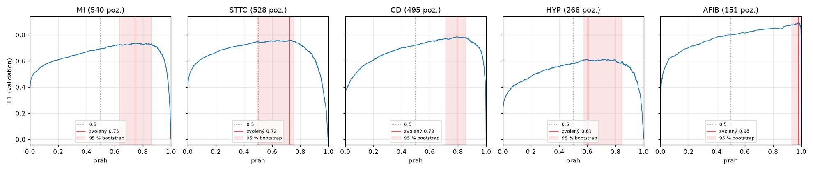

# Rozhodovacie prahy pre labely (issue #17)

Kód: [`src/ekg/label_thresholds.py`](../src/ekg/label_thresholds.py) ·
Uložené prahy: [`docs/vysledky/clf_v1/prahy.json`](vysledky/clf_v1/prahy.json)
(kópia `checkpoints/clf_v1/thresholds.json`, GitHub Release `model-clf_v1`)

```bash
uv run ekg-calibrate-clf              # výpočet a porovnanie, nič neukladá
uv run ekg-calibrate-clf --save       # uloží prahy k checkpointu
```

Klasifikátor (#16) vracia pre každý z 5 labelov pravdepodobnosť. Label je **pozitívny, ak
pravdepodobnosť ≥ prah daného labelu**. Každý label má vlastný prah, lebo labely sú rôzne časté
a model je pre ne rôzne istý.

## Kritérium (určené vopred)

Kritérium som zvolil **pred pohľadom na výsledky**:

1. **Prah s maximálnym F1 na validation**, pre každý label zvlášť.
   F1 = 2·TP / (2·TP + FP + FN) vyvažuje prehliadnuté poruchy (FN) a falošné poplachy (FP).
2. Pri zhode F1 sa zvolí **vyšší prah** (menej falošných poplachov).
3. Prah sa uloží **v strede** medzi dvoma susednými hodnotami pravdepodobnosti na validation.
   Na validation to dá rovnaké rozhodnutia, ale malý rozdiel vo výpočte (iný hardvér, iná presnosť)
   nezmení výsledok záznamu, ktorý leží presne na hranici.

**Prečo nie požadovaná citlivosť?** Na pevnú cieľovú citlivosť (napr. 90 %) by bolo treba klinické
zdôvodnenie, aká chyba je prijateľná, a to v projekte nemáme. Nástroj nie je lekárska diagnostika,
F1 je teda neutrálna voľba. Ak by bolo treba citlivosť zvýšiť, stačí zmeniť prah; F1 krivky sú
v grafe nižšie.

**Postup pri nedostatku dát:** ak má label na validation **menej ako 30 pozitívnych alebo menej ako
30 negatívnych** príkladov, F1 sa neoptimalizuje a použije sa **náhradný prah 0,5**. Model je
trénovaný s `pos_weight = neg / pos` (#16), takže 0,5 zodpovedá rozhodnutiu, akoby boli pozitívne
a negatívne príklady rovnako časté. V `prahy.json` je potom `"method": "fallback"` s dôvodom.
Pri `clf_v1` **náhradný prah nebol potrebný** – najmenej pozitívnych má AFIB (151).

Prečo práve 30: pri AFIB som náhodne vybral iba *n* pozitívnych (a polovicu negatívnych) záznamov,
na nich zvolil prah a zmeral F1 na zvyšku validation; 300 opakovaní. Najhorších 2,5 % výsledkov:

| pozitívnych na výber prahu | 10 | 20 | 30 | 60 |
|---|---|---|---|---|
| F1 na zvyšku (2,5 % kvantil) | 0,60 | 0,76 | 0,84 | 0,84 |

Pevný prah 0,5 dal v tom istom pokuse 0,83. Pri 10–20 pozitívnych môže optimalizácia dopadnúť
výrazne horšie ako náhradný prah, od ~30 je porovnateľná. Ide len o orientačný pokus (podvzorkovanie
mení aj podiel pozitívnych), skript nie je súčasťou repozitára.

**Test množina sa nepoužíva** – prahy sa počítajú iba z validation (`make_loader("val", "classifier")`),
test je zamknutý pre #22.

## Dáta

Validation, podmnožina `classifier`: **2 150 záznamov od 1 919 pacientov**, pravdepodobnosti vo
float32 z najlepšej epochy `clf_v1` (epocha 20, SHA256 checkpointu je v `prahy.json`).

| label | pozitívne | negatívne |
|---|---|---|
| MI | 540 | 1 610 |
| STTC | 528 | 1 622 |
| CD | 495 | 1 655 |
| HYP | 268 | 1 882 |
| AFIB | 151 | 1 999 |

## Výsledok



| label | prah | 95 % CI prahu (bootstrap) | F1 val | 95 % CI F1 | F1 krížová validácia | senzitivita | špecificita | precision |
|---|---|---|---|---|---|---|---|---|
| MI | **0,746** | 0,63 – 0,86 | 0,737 | 0,71 – 0,76 | 0,725 | 0,798 | 0,876 | 0,684 |
| STTC | **0,724** | 0,49 – 0,76 | 0,760 | 0,73 – 0,79 | 0,753 | 0,773 | 0,915 | 0,747 |
| CD | **0,792** | 0,71 – 0,86 | 0,787 | 0,76 – 0,81 | 0,785 | 0,782 | 0,938 | 0,791 |
| HYP | **0,606** | 0,58 – 0,85 | 0,612 | 0,57 – 0,66 | 0,594 | 0,757 | 0,898 | 0,514 |
| AFIB | **0,981** | 0,93 – 0,99 | 0,897 | 0,86 – 0,93 | 0,884 | 0,894 | 0,992 | 0,900 |

- **95 % CI prahu:** validation sa 1 000× náhodne prevzorkuje s opakovaním a na každej vzorke sa
  znova zvolí prah. **95 % CI F1:** F1 pevného zvoleného prahu na tých istých vzorkách.
- **Krížová validácia:** validation sa rozdelí na 5 častí **po pacientoch**; prah sa zvolí na 4 častiach
  a rozhodnutia sa vyhodnotia na piatej. Je to poctivejší odhad, lebo prah sa nehodnotí na dátach,
  na ktorých bol vybraný.

### Porovnanie s pevným prahom 0,5

| label | prah | senzitivita | špecificita | precision | F1 | FP | FN |
|---|---|---|---|---|---|---|---|
| MI | 0,5 | 0,913 | 0,758 | 0,558 | 0,693 | 390 | 47 |
| | 0,746 | 0,798 | 0,876 | 0,684 | **0,737** | 199 | 109 |
| STTC | 0,5 | 0,892 | 0,838 | 0,642 | 0,746 | 263 | 57 |
| | 0,724 | 0,773 | 0,915 | 0,747 | **0,760** | 138 | 120 |
| CD | 0,5 | 0,885 | 0,829 | 0,607 | 0,720 | 283 | 57 |
| | 0,792 | 0,782 | 0,938 | 0,791 | **0,787** | 102 | 108 |
| HYP | 0,5 | 0,806 | 0,861 | 0,453 | 0,580 | 261 | 52 |
| | 0,606 | 0,757 | 0,898 | 0,514 | **0,612** | 192 | 65 |
| AFIB | 0,5 | 0,960 | 0,967 | 0,687 | 0,801 | 66 | 6 |
| | 0,981 | 0,894 | 0,992 | 0,900 | **0,897** | 15 | 16 |

| macro F1 (priemer 5 labelov) | |
|---|---|
| prah 0,5 | 0,708 |
| zvolené prahy, na validation | 0,758 |
| zvolené prahy, krížová validácia po pacientoch | **0,748** |

Celá tabuľka: [`prahy_porovnanie.csv`](vysledky/clf_v1/prahy_porovnanie.csv).

## Čo z toho vyplýva

- **Všetky prahy sú vyššie ako 0,5.** Potvrdzuje to zistenie z #16: tréning s `pos_weight` posúva
  pravdepodobnosti nahor. Pri prahu 0,5 má model vysokú citlivosť, ale veľa falošných poplachov
  (MI 390 FP).
- **AFIB má prah až 0,98.** AFIB je najzriedkavejší label a má najväčší `pos_weight` (13,15), preto
  je jeho posun najväčší. Model AFIB rozpoznáva veľmi dobre (AUROC 0,99), takže vysoký prah zníži
  falošné poplachy zo 66 na 15 za cenu 10 ďalších prehliadnutých záznamov.
- **Zvolené prahy menia citlivosť za presnosť.** Senzitivita klesá (MI 0,91 → 0,80), špecificita
  a precision rastú. Je to dôsledok kritéria F1; pri skríningu, kde je prehliadnutie horšie ako falošný
  poplach, by bol vhodnejší nižší prah.
- **Prírastok je reálny, ale menší, ako ukazuje validation.** Krížová validácia dáva macro F1 0,748
  namiesto 0,758 – výber prahu na tých istých dátach nadhodnocuje F1 asi o 0,01. Oproti prahu 0,5 je
  zlepšenie stále ~0,04.
- **Presná hodnota prahu nie je kritická.** Intervaly prahu sú široké (HYP 0,58 – 0,85, STTC 0,49 – 0,76),
  ale F1 krivky sú v tejto oblasti takmer ploché – iný prah z intervalu by F1 zmenil len málo.
- **HYP ostáva najslabší** (F1 0,61, precision 0,51) – takmer každé druhé označenie HYP je falošný poplach.

## Presnosť výpočtu

Prahy sú počítané z pravdepodobností vo **float32** (bez autocastu). V bfloat16 sa pravdepodobnosti
líšia najviac o 0,024 a pri zvolených prahoch sa zmení **28 z 10 750 rozhodnutí** (0,26 %).
Inference (#19) má preto počítať vo float32 – tak, ako boli prahy nastavené.

## Obmedzenie

Validation sa už použila na výber epochy a early stopping (#16) a teraz aj na prahy. Metriky v tomto
dokumente sú preto mierne optimistické. Nezávislé vyhodnotenie s týmito prahmi bude až na test
množine v #22.

## Uložený súbor

`prahy.json` (= `checkpoints/clf_v1/thresholds.json`) obsahuje:

| kľúč | obsah |
|---|---|
| `version` | verzia formátu prahov (1.0) |
| `run`, `checkpoint_sha256`, `checkpoint_epoch`, `model_versions` | ku ktorému modelu prahy patria (preprocessing, mapovanie labelov, rozdelenie dát, torch) |
| `label_order` | poradie labelov podľa kontraktu – `load_thresholds()` iné poradie odmietne |
| `criterion`, `min_pos`, `min_neg`, `fallback_threshold` | pravidlo výberu |
| `calibrated_on` | split `val`, počet záznamov a pacientov, presnosť, macro F1 |
| `labels.<label>` | prah, metóda (`f1` / `fallback`), počty pozitívnych a negatívnych, matica zámen a metriky, bootstrap, F1 z krížovej validácie |

V kóde: `label_thresholds.load_thresholds(path)` a `label_thresholds.apply(probs, data)` → rozhodnutia (N, 5).

## Overenie (testy)

`tests/test_label_thresholds.py` – 13 testov: matica zámen a prah vrátane rovnosti, F1 krivka
sa zhoduje s výpočtom pre každý prah, stredný prah nemení rozhodnutia, pri zhode sa volí vyšší prah,
zvolený prah má naozaj maximum F1, náhradný prah pri malom počte pozitívnych, krížová validácia nedá
vyššie F1 ako optimum, odmietnutie iného poradia labelov a inej verzie, uloženie cez CLI (SHA256
checkpointu, verzie modelu) a kontrola uloženého `prahy.json` vrátane zhody s checkpointom.
