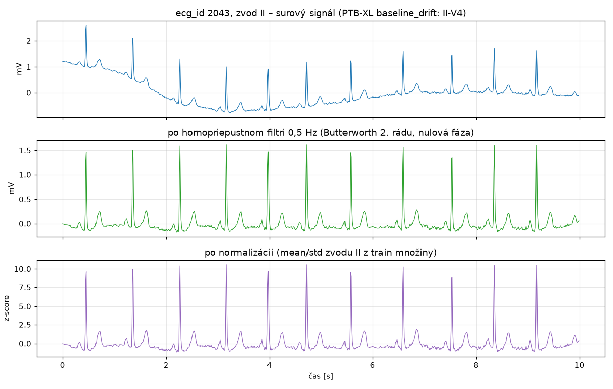

# Preprocessing a normalizácia (verzia 1.0)

Kód: [`src/ekg/preprocessing.py`](../src/ekg/preprocessing.py) · Parametre:
[`manifests/preprocessing_v1.0.json`](../manifests/preprocessing_v1.0.json) · Spustenie: `uv run ekg-preprocess`

## Kroky

| # | Krok | Učí sa z dát? | Prečo |
|---|---|---|---|
| 1 | hornopriepustný Butterworth filter **0,5 Hz**, 2. rád, nulová fáza (`sosfiltfilt`) | nie | odstráni drift základnej línie (dýchanie, pohyb, elektródy) |
| 2 | **z-score po zvodoch**: `(x − mean[zvod]) / std[zvod]` | áno, **iba z train** | zjednotí mierku zvodov (hrudné zvody V2, V3 majú ~2× väčšiu amplitúdu ako končatinové) |

Rovnaký `Preprocessor` s tými istými uloženými parametrami sa používa pre train, validation, test
aj inference.

### Prečo práve takto

- **0,5 Hz a nulová fáza:** drift má frekvenciu pod ~0,5 Hz, srdcová frekvencia je nad 0,67 Hz
  (40 úderov/min). Filter s nulovou fázou (signál sa filtruje dopredu aj dozadu) neposúva vlny
  v čase a nedeformuje ST segment, čo je dôležité pre labely STTC a MI.
- **Dolnopriepustný filter nie je potrebný:** pri 100 Hz je najvyššia zachytená frekvencia 50 Hz.
  PTB-XL je už pri zmenšení na 100 Hz odfiltrovaný.
- **Normalizácia po zvodoch s parametrami z celej train množiny, nie z každého záznamu zvlášť:**
  normalizácia každého záznamu by zmazala absolútnu amplitúdu, a tá nesie diagnostickú informáciu
  (napr. napäťové kritériá hypertrofie, HYP). Test `test_amplitude_differences_between_records_are_kept`
  to overuje.
- Po filtri je priemer každého zvodu prakticky 0, takže normalizácia v praxi iba vydelí
  smerodajnou odchýlkou zvodu.

## Ochrana pred únikom informácií

- `mean` a `std` sa počítajú **iba** z 17 418 záznamov train množiny (`split_ids("train")`).
  Validation a test sa pri fite vôbec nenačítajú.
- Súbor s parametrami obsahuje, z čoho vznikli: split, počet záznamov a SHA256 manifestu.
- Test `test_params_depend_only_on_fit_data` overuje, že zmena iných dát parametre nezmení.
  Test `test_committed_params_match_refit_on_train` overuje, že parametre v gite sa dajú presne
  zopakovať z train dát.
- Kontrola na validation: po normalizácii je priemer 0,000 a std 0,978, teda blízko 1, ale nie
  presne. To je správne, lebo parametre nepochádzajú z validation.

## Naučené parametre (train, po filtri)

| zvod | I | II | III | AVR | AVL | AVF | V1 | V2 | V3 | V4 | V5 | V6 |
|---|---|---|---|---|---|---|---|---|---|---|---|---|
| std [mV] | 0,149 | 0,152 | 0,147 | 0,131 | 0,127 | 0,130 | 0,208 | 0,323 | 0,315 | 0,283 | 0,247 | 0,197 |

## Príklad

Záznam `ecg_id 2043` (zvod II) má podľa PTB-XL drift základnej línie. Rozdiel priemeru prvej
a poslednej sekundy klesol filtrom z 1,12 mV na 0,01 mV. Tvar QRS komplexov, ST segmentu
a T vĺn zostal zachovaný.

## Kontroly

- `fit()` odmietne zvod s nulovou varianciou (plochý zvod vo všetkých dátach).
- `transform()` overí tvar `(12, 1000)` / `(B, 12, 1000)` a že výsledok neobsahuje NaN ani nekonečno.
- `load()` odmietne parametre inej verzie alebo s iným poradím zvodov.

## Cache signálov

Načítanie všetkých 21 799 záznamov cez WFDB trvá ~4 minúty. `ekg-preprocess` ich preto raz uloží do
`data/processed/signals_100hz.npy` (1,05 GB, mimo gitu) v poradí manifestu. Potom sa čítajú za
zlomok sekundy (`SignalCache`), čo využije aj dátový loader (#9). Cache obsahuje **nespracované**
signály, takže zmena preprocessingu nevyžaduje novú cache.
