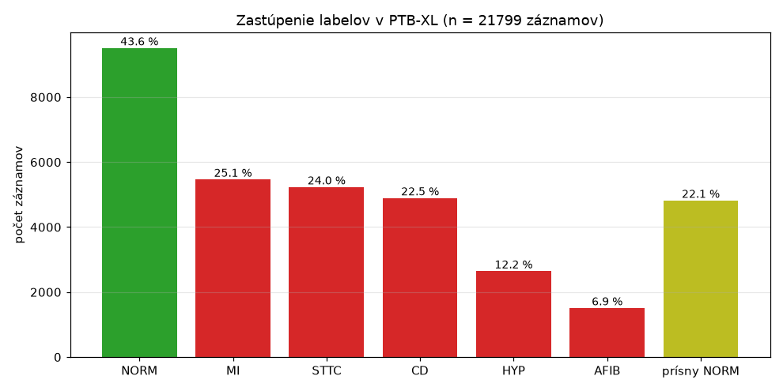
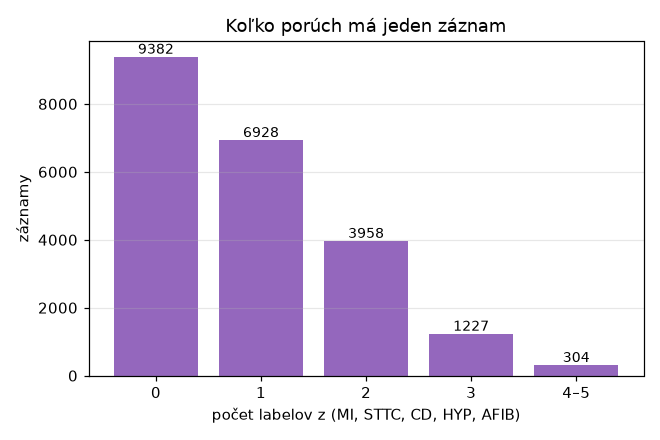
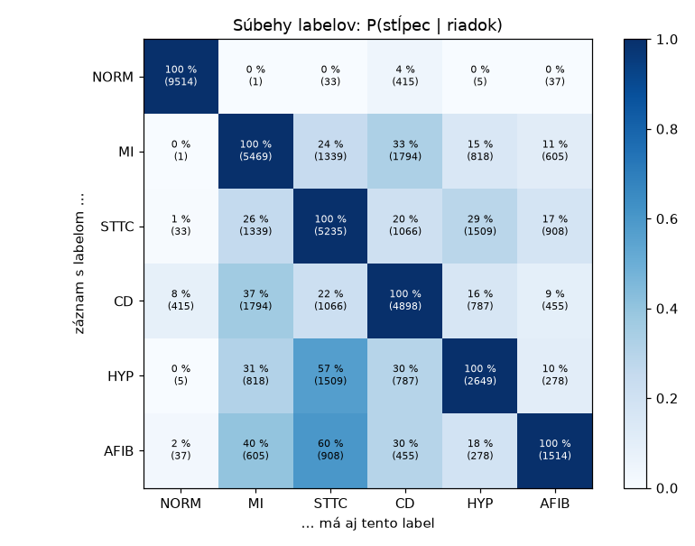
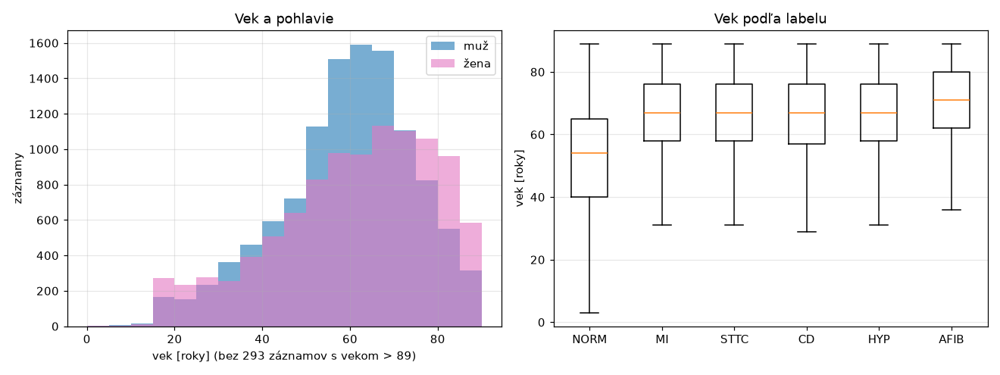

# Prieskum datasetu PTB-XL

Kód: [`src/ekg/data/explore.py`](../src/ekg/data/explore.py) · Spustenie: `uv run ekg-explore` ·
Tabuľky: [`docs/vysledky/prieskum/`](vysledky/prieskum/)

Čísla vychádzajú z PTB-XL v1.0.3, mapovania labelov v1.0 (#4), rozdelenia v1.0 (#6) a kontroly kvality v1.0 (#7).

## Základné údaje

| | |
|---|---|
| záznamy | **21 799** (12 zvodov, 10 s, 100 Hz) |
| pacienti | **18 869**. 16 758 má 1 záznam, najviac 10 záznamov na pacienta |
| obdobie nahrávania | podľa popisu datasetu **október 1989 – jún 1996**; stĺpec `recording_date` však obsahuje dátumy 1984–2001 (iba 58 % v uvedenom období), pravdepodobne kvôli posunu dátumov pri anonymizácii (neoverené) |
| prístroje | **11 typov** (výrobca Schiller AG, napr. CS100, CS-12, AT-6) |
| pracoviská | 51 (`site`) |
| anotácie overené človekom | 16 056 (74 %). Validation a test (foldy 9 a 10) sú overené celé |

> **Oprava oproti pôvodným poznámkam:** záznamy nie sú z jedného typu prístroja, ale z **11 typov** (stĺpec `device`).
> Limitácia „jeden zdroj“ však platí: jedna inštitúcia (Physikalisch-Technische Bundesanstalt, Nemecko)
> a jeden výrobca prístrojov.
>
> Pozor na dátumy: rozdiel medzi popisom datasetu (1989–1996) a stĺpcom `recording_date` (1984–2001) som
> nevedel s istotou vysvetliť. V práci treba uviesť obdobie z popisu datasetu a dátumy z CSV nepoužívať.

## Chýbajúce hodnoty

| | záznamy | podiel |
|---|---|---|
| vek chýba | 0 | 0 % |
| **vek > 89 rokov** (PTB-XL uvádza 300) | 293 | 1,3 % |
| pohlavie chýba | 0 | 0 % |
| výška chýba | 14 825 | 68 % |
| hmotnosť chýba | 12 378 | 57 % |
| bez diagnostického kódu aj AFIB (vynechané z Modelu B, #4) | 348 | 1,6 % |

Vek a pohlavie sú dostupné takmer vždy. Výška a hmotnosť chýbajú vo väčšine záznamov, preto sa nepoužívajú.

## Zastúpenie labelov

Menovateľ = všetky záznamy množiny:

| | train | val | test | spolu |
|---|---|---|---|---|
| NORM (kód NORM) | 7 596 (43,6 %) | 955 (43,7 %) | 963 (43,8 %) | 9 514 (43,6 %) |
| MI | 4 379 (25,1 %) | 540 (24,7 %) | 550 (25,0 %) | 5 469 (25,1 %) |
| STTC | 4 186 (24,0 %) | 528 (24,2 %) | 521 (23,7 %) | 5 235 (24,0 %) |
| CD | 3 907 (22,4 %) | 495 (22,7 %) | 496 (22,6 %) | 4 898 (22,5 %) |
| HYP | 2 119 (12,2 %) | 268 (12,3 %) | 262 (11,9 %) | 2 649 (12,2 %) |
| **AFIB** | 1 211 (7,0 %) | 151 (6,9 %) | 152 (6,9 %) | **1 514 (6,9 %)** |
| prísny NORM (#4) | 3 905 (22,4 %) | 454 (20,8 %) | 464 (21,1 %) | 4 823 (22,1 %) |

- **Nevyváženosť:** AFIB (7 %) a HYP (12 %) sú 2–4× zriedkavejšie ako MI a STTC. Treba to riešiť pri tréningu
  (`pos_weight`, #16) a hodnotiť metrikami, ktoré nevyváženosť zohľadňujú (AUPRC, F1 po labeloch, #18).
- Podiely sú v train, val a test takmer rovnaké. Stratifikácia `strat_fold` funguje (#6).

## Koľko porúch má jeden záznam

| labelov z (MI, STTC, CD, HYP, AFIB) | 0 | 1 | 2 | 3 | 4–5 |
|---|---|---|---|---|---|
| záznamy | 9 382 | 6 928 | 3 958 | 1 227 | 304 |

**5 489 záznamov (25 %) má 2 a viac porúch naraz.** Preto je Model B multi-label (5 nezávislých sigmoidov),
nie multi-class (#15).

## Súbehy labelov

Bunka = P(záznam má label v stĺpci | má label v riadku), v zátvorke počet záznamov.

- **AFIB takmer nikdy nie je sama:** 60 % záznamov s AFIB má aj STTC a 40 % aj MI. Samotná AFIB je zriedkavá.
  Pri vyhodnotení AFIB (#14, #18) to treba mať na pamäti.
- **HYP + STTC:** 57 % záznamov s HYP má aj STTC. Hypertrofia často mení aj repolarizáciu (ST/T).
- **MI + CD** je najčastejšia dvojica (1 794 záznamov, 33 % MI).
- **NORM a poruchy sa takmer vylučujú.** Výnimka sú CD (415 záznamov NORM + CD, napr. inkompletná blokáda
  pravého ramienka sa považuje za variant normy) a 37 záznamov NORM + AFIB (NORM opisuje tvar, AFIB rytmus).

Najčastejšie kombinácie: NORM 41,4 % · MI 10,7 % · STTC 9,1 % · CD 7,2 % · MI + CD 5,3 % · STTC + HYP 3,0 % · HYP 2,4 % · …

## Vek, pohlavie a kvalita

| | záznamy | vek (medián) | vek > 89 | ženy | kvalita: warning |
|---|---|---|---|---|---|
| NORM | 9 514 | **54** | 0,3 % | 54 % | 21,5 % |
| MI | 5 469 | 67 | 2,2 % | **38 %** | 25,8 % |
| STTC | 5 235 | 67 | 2,6 % | 51 % | 23,7 % |
| CD | 4 898 | 67 | 2,9 % | **39 %** | 23,1 % |
| HYP | 2 649 | 67 | 2,1 % | 43 % | 20,1 % |
| AFIB | 1 514 | **71** | 4,2 % | 44 % | 28,6 % |
| všetky | 21 799 | 61 | 1,3 % | 48 % | 23,0 % |

- **Vek silne súvisí s diagnózou:** normálne EKG majú pacienti s mediánom 54 rokov, patológie 67–71 rokov.
  Model sa môže čiastočne naučiť „vek“ namiesto poruchy (napr. starnutím sa mení amplitúda a os). Na to
  treba myslieť pri analýze podľa veku (#26) a pri pridaní veku ako vstupu (#30).
- **MI a CD sú častejšie u mužov** (38–39 % žien oproti 54 % pri NORM).
- **AFIB má najviac problémov s kvalitou** (28,6 % warning). Nepravidelný rytmus a vlnenie základnej
  línie (f-vlny) sa zrejme častejšie anotujú ako šum.
- Kvalita v množinách: train 22,7 %, val 24,9 %, test 24,0 % záznamov s warning.

## Limitácie datasetu (do práce)

1. **Jeden zdroj:** jedna inštitúcia, jeden výrobca prístrojov, Nemecko, roky 1989–1996 (podľa popisu datasetu). Výsledky sa nemusia
   preniesť na iné prístroje a populácie (externá validácia #31).
2. **Nie všetky anotácie overil človek:** 26 % záznamov má iba automatickú alebo neoverenú anotáciu (iba v train).
3. **Nevyvážené labely:** AFIB 7 %, HYP 12 %.
4. **Silné súbehy** (AFIB + STTC, HYP + STTC): model sa môže naučiť súbeh namiesto samotnej poruchy.
5. **Vek ako zmätočný faktor:** pacienti s patológiou sú v priemere o 13 rokov starší.
6. **Vek > 89 je anonymizovaný** (293 záznamov) a výška a hmotnosť väčšinou chýbajú.
