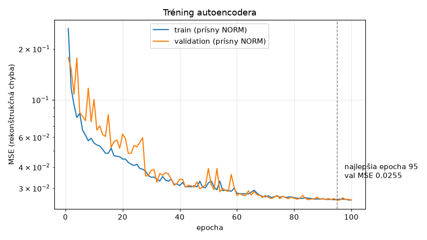
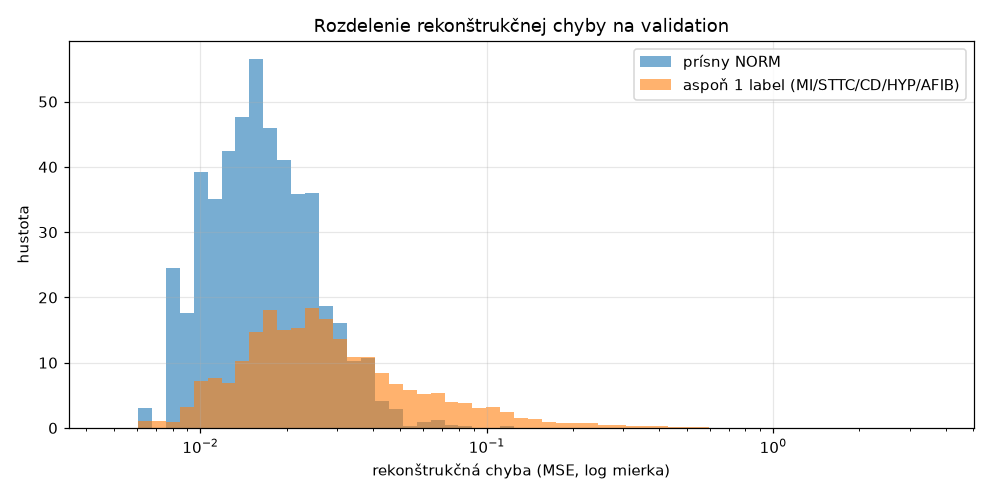

# Tréning autoencodera (beh `ae_v1`)

Kód: [`src/ekg/training/train_autoencoder.py`](../src/ekg/training/train_autoencoder.py) ·
Konfigurácia: [`configs/autoencoder.yaml`](../configs/autoencoder.yaml) ·
Výsledky: [`docs/vysledky/ae_v1/`](vysledky/ae_v1/)

```bash
uv run ekg-train-ae            # tréning (Intel Mac, CPU: ~15–20 s / epocha)
uv run ekg-train-ae --resume   # pokračovanie po prerušení
uv run ekg-ae-report           # diagnostika na validation
```

## Nastavenie

| | |
|---|---|
| dáta | train: **3 905** záznamov prísneho NORM · validation: 454 záznamov prísneho NORM (#4, #6) |
| model | `ConvAutoencoder`, 321 436 parametrov, hrdlo 16 × 125 (#10) |
| loss | MSE (= rekonštrukčná chyba #12) |
| optimizer | Adam, lr 0,001, dávka 64 |
| plánovač | ReduceLROnPlateau (×0,5 po 4 epochách bez zlepšenia val loss) |
| zastavenie | max. 100 epoch, early stopping po 12 epochách bez zlepšenia |
| seed | 42 (poradie miešania závisí iba od seedu a epochy) |

**Prerušenie nevadí:** po každej epoche sa uloží celý stav (váhy, optimizer, plánovač, early stopping,
RNG). `--resume` pokračuje od nasledujúcej epochy. Test dokazuje, že tréning prerušený a obnovený dá
**bitovo rovnaké** váhy aj metriky ako tréning bez prerušenia.

## Priebeh



| epocha | train MSE | val MSE | lr |
|---|---|---|---|
| 1 | 0,264 | 0,178 | 1e-3 |
| 10 | 0,056 | 0,101 | 1e-3 |
| 30 | 0,035 | 0,038 | 5e-4 |
| 60 | 0,028 | 0,027 | 1,25e-4 |
| **95 (najlepšia)** | 0,026 | **0,0255** | 1,6e-5 |
| 100 | 0,026 | 0,0255 | 7,8e-6 |

- Celkovo 100 epoch za **26,5 min** na CPU (Intel Mac).
- **Bez preučenia:** train a val loss sú na konci prakticky rovnaké. Model sa naučil všeobecný tvar
  normálneho EKG, nie konkrétne záznamy.
- Early stopping nezasiahol, lebo loss sa stále mierne zlepšovala. Plánovač však znížil lr až na 8e-6,
  takže ďalšie epochy by priniesli už len zanedbateľné zlepšenie.
- Kolísanie val loss v prvých ~50 epochách je pri malej validation množine (454 záznamov) a vysokom lr bežné.

## Rozlišuje autoencoder normálne a patologické EKG? (validation)



| Skupina | záznamy | medián chyby | 90. percentil |
|---|---|---|---|
| prísny NORM | 454 | **0,020** | 0,038 |
| bez labelu, nie prísny NORM | 489 | 0,026 | 0,098 |
| MI | 540 | 0,065 | 0,282 |
| STTC | 528 | 0,051 | 0,215 |
| CD | 495 | 0,083 | 0,410 |
| HYP | 268 | 0,085 | 0,366 |
| AFIB | 151 | 0,099 | 0,311 |
| aspoň 1 label | 1 240 | 0,052 | 0,259 |

**AUROC prísny NORM vs. aspoň 1 label = 0,832** (agregácia priemerom cez zvody), resp. 0,793 (najhorší zvod).

### Interpretácia

- Autoencoder, ktorý **nikdy nevidel žiadnu patológiu**, oddelí normálne EKG od patologických
  výrazne lepšie ako náhoda (0,5).
- Najväčšiu chybu majú **CD, HYP a AFIB** (medián 4–5× vyšší ako NORM). Tieto poruchy menia tvar QRS
  (blokády, hypertrofia) alebo rytmus (nepravidelné RR, chýbajúca P vlna), a to sa „normálnym“ dekóderom
  zle napodobňuje.
- **MI a STTC** sú bližšie k NORM. Zmeny ST segmentu a T vlny sú amplitúdovo malé a pri MSE cez celý
  signál sa strácajú.
- Rozdelenia sa **výrazne prekrývajú**: časť patologických záznamov autoencoder zrekonštruuje dobre.
  To sa očakávalo (autoencoder sa naučí aj všeobecné tvary, ktoré má patologické EKG spoločné s normálnym).
  Je to dôvod, prečo je v systéme aj klasifikátor (Model B). Podrobná analýza chýb je v #14.
- **Priemer cez zvody vychádza lepšie ako maximum** (0,832 vs. 0,793). Najhorší zvod je zrejme citlivejší
  na lokálne artefakty v normálnych záznamoch. Otvorenú otázku z #12 to zatiaľ rozhoduje v prospech priemeru.
  Definitívne sa rozhodne pri kalibrácii prahu (#13).
- Skupina „bez labelu, nie prísny NORM“ (napr. NORM so šumom alebo s form kódom) má chybu medzi NORM
  a patológiou, čo dáva zmysel.

## Checkpoint

`checkpoints/ae_v1/best.pt` (1,3 MB, mimo gitu, SHA256 začína `b9214cde491f8e79`) obsahuje váhy
z epochy 95, konfiguráciu, kontrakt a verzie preprocessingu, mapovania a splitov.
