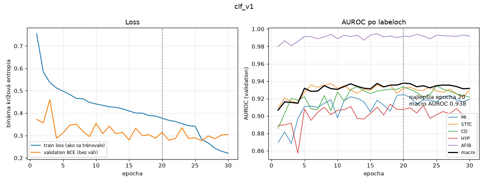

# Tréning klasifikátora (beh `clf_v1`, issue #16)

Kód: [`src/ekg/training/train_classifier.py`](../src/ekg/training/train_classifier.py) ·
Konfigurácia: [`configs/classifier.yaml`](../configs/classifier.yaml) ·
Výsledky: [`docs/vysledky/clf_v1/`](vysledky/clf_v1/)

```bash
uv run ekg-train-clf                                          # tréning podľa konfigurácie (clf_v1)
uv run ekg-train-clf --resume                                 # pokračovanie po prerušení
uv run ekg-train-clf --pos-weight none --run-name clf_v1_bez_vah   # porovnávací beh bez váh
uv run ekg-clf-compare clf_v1 clf_v1_bez_vah                  # tabuľka najlepších val metrík
```

Prepínače `--run-name`, `--pos-weight train|none`, `--amp bf16|none`, `--seed`, `--max-epochs`
prepíšu konfiguráciu; skutočne použitá konfigurácia sa uloží do `outputs/<run_name>/config.yaml`.

## Nastavenie

| | |
|---|---|
| dáta | train: **17 135** záznamov · validation: **2 150** záznamov (podmnožina `classifier`, #4, #6) |
| model | `ResNet1dClassifier`, 2,18 mil. parametrov (#15) |
| loss | `BCEWithLogitsLoss` s `pos_weight` z train množiny (nižšie) |
| optimizer | Adam, lr 0,001, weight decay 0,0001, dávka 64 |
| plánovač | ReduceLROnPlateau na val macro AUROC (×0,5 po 4 epochách bez zlepšenia) |
| zastavenie | max. 60 epoch, early stopping po 10 epochách bez zlepšenia val macro AUROC o ≥ 0,0005 |
| presnosť | zmiešaná bfloat16 na GPU (#28), váhy vo float32 |
| seed | 42 (poradie miešania závisí iba od seedu a epochy) |
| hardvér | AMD RX 9070 XT (WSL2, ROCm 10.1), ~4 s na epochu, celý beh **2,5 min** |

**Výber modelu podľa val macro AUROC, nie podľa val loss.** Beh s váhami a beh bez nich optimalizujú
inú loss, takže ich straty sa nedajú porovnať. AUROC nezávisí od prahu – prahy pre jednotlivé labely
sa nastavia až v #17. Test množina sa v tréningu nepoužíva vôbec: konfigurácia so splitom `test`
skončí chybou (#22).

**Prerušenie nevadí:** po každej epoche sa uloží celý stav (váhy, optimizer, plánovač, early stopping,
RNG vrátane GPU). Test dokazuje, že na CPU dá prerušený a obnovený tréning **bitovo rovnaké** váhy
aj metriky. Na GPU nie je výsledok bitovo reprodukovateľný ani bez prerušenia (MIOpen používa
nedeterministické algoritmy), preto sa porovnávajú behy s viacerými seedmi.

## Nevyváženosť labelov – početnosti v train množine

| label | pozitívne | negatívne | podiel | `pos_weight` = neg / pos |
|---|---|---|---|---|
| MI | 4 379 | 12 756 | 25,6 % | 2,91 |
| STTC | 4 186 | 12 949 | 24,4 % | 3,09 |
| CD | 3 907 | 13 228 | 22,8 % | 3,39 |
| HYP | 2 119 | 15 016 | 12,4 % | 7,09 |
| AFIB | 1 211 | 15 924 | 7,1 % | **13,15** |

`pos_weight` násobí v loss člen pre pozitívne príklady: prehliadnutý AFIB stojí 13× viac ako bez váh,
akoby pozitívnych a negatívnych príkladov bolo rovnako. Počíta sa **iba z train množiny**
(uložené v `report.json` aj v checkpointe).

## Porovnanie: bez váh vs. s `pos_weight`

Každá varianta 3× s rôznym seedom (42, 1, 2) – rozdiel medzi variantmi má zmysel, iba ak je väčší
ako rozptyl medzi seedmi. Najlepšia epocha každého behu, validation, priemer ± smerodajná odchýlka:

| metrika (validation) | bez váh | s `pos_weight` |
|---|---|---|
| macro AUROC | 0,939 ± 0,002 | 0,939 ± 0,001 |
| macro AUPRC | 0,819 ± 0,007 | 0,819 ± 0,005 |
| AUROC MI | 0,929 ± 0,003 | 0,926 ± 0,003 |
| AUROC STTC | 0,931 ± 0,002 | 0,933 ± 0,002 |
| AUROC CD | 0,933 ± 0,002 | 0,930 ± 0,003 |
| AUROC HYP | 0,912 ± 0,002 | 0,911 ± 0,004 |
| AUROC AFIB | 0,989 ± 0,003 | **0,993 ± 0,001** |
| AUPRC AFIB | 0,925 ± 0,019 | **0,939 ± 0,006** |
| AUPRC HYP | 0,678 ± 0,004 | 0,674 ± 0,004 |
| val BCE bez váh (kalibrácia) | **0,224 ± 0,004** | 0,296 ± 0,016 |

Všetky behy: [`porovnanie_behov.csv`](vysledky/clf_v1/porovnanie_behov.csv),
súhrn: [`porovnanie_seedy.json`](vysledky/clf_v1/porovnanie_seedy.json).

**Čo z toho vyplýva:**
- **Celkovo rovnaké.** Macro AUROC aj AUPRC sú zhodné; pri MI, STTC, CD a HYP sú rozdiely v rozsahu
  rozptylu medzi seedmi.
- **`pos_weight` pomáha iba najzriedkavejšiemu labelu – AFIB:** vyššie AUROC aj AUPRC vo všetkých troch
  seedoch a výrazne menší rozptyl (AUPRC ±0,006 vs. ±0,019). AFIB je v train iba 7 %.
- **Cena: horšia kalibrácia.** S váhami model systematicky nadhodnocuje pravdepodobnosť pozitívneho
  labelu (nevážené val BCE 0,296 vs. 0,224) – výstup 0,5 neznamená „50 % záznamov s takým výstupom
  má poruchu“. Poradie záznamov (a teda AUROC) sa nemení.
- **Prekvapenie:** čakal som, že váhy výrazne pomôžu aj HYP (12 %), ale nepomohli. Pri AUROC na tom
  nezáleží, lebo AUROC samo nevyváženosť zohľadňuje; HYP ostáva najslabší label (AUPRC 0,67), ako
  predpovedal benchmark (Strodthoff 2020).

**Rozhodnutie: `clf_v1` = s `pos_weight`, seed 42** (beh podľa konfigurácie). Dôvody: rovnaký celkový
výkon, stabilnejší a lepší AFIB; horšiu kalibráciu vyrieši #17, kde sa prah každého labelu nastaví
na validation (nie pevne 0,5) – výsledok v [prahy_labelov.md](prahy_labelov.md). Za finálny beh **nevyberám najlepší seed** (s1 mal macro AUROC 0,940),
lebo výber najlepšieho z viacerých pokusov na validation by výsledok nadhodnotil.

## Priebeh `clf_v1`



| epocha | train loss (vážená) | val BCE | val macro AUROC | lr |
|---|---|---|---|---|
| 1 | 0,754 | 0,372 | 0,907 | 1e-3 |
| 5 | 0,498 | 0,312 | 0,932 | 1e-3 |
| 10 | 0,441 | 0,355 | 0,931 | 1e-3 |
| **20 (najlepšia)** | 0,377 | 0,314 | **0,938** | 1e-3 |
| 25 | 0,341 | 0,290 | 0,935 | 5e-4 |
| 30 (koniec) | 0,221 | 0,305 | 0,932 | 2,5e-4 |

- Macro AUROC dosiahne ~0,93 už po 5 epochách, potom sa zlepšuje už len pomaly.
- Po prvom znížení lr (epocha 25) train loss prudko klesá, ale validation sa nezlepšuje – model sa
  začína učiť naspamäť. Early stopping zastavil tréning v epoche 30 (10 epoch bez zlepšenia).
- Val BCE kolíše viac ako AUROC – pri váženom tréningu sa mení najmä kalibrácia, nie poradie.

Najlepšia epocha `clf_v1` (validation): **macro AUROC 0,938**, macro AUPRC 0,819;
AUROC MI 0,925 · STTC 0,932 · CD 0,933 · HYP 0,907 · AFIB 0,992. Benchmark Strodthoff 2020
(superdiagnostické triedy PTB-XL, iné labely) uvádza macro AUROC ~0,93 – sme na porovnateľnej úrovni.
Konečné vyhodnotenie s prahmi a metrikami po labeloch je v [vyhodnotenie_klasifikatora.md](vyhodnotenie_klasifikatora.md) (#18), na test množine až v #22.

## bfloat16 vs. float32

Rovnaká konfigurácia (s váhami, seed 42) vo float32: macro AUROC **0,939** (bf16: 0,938), macro AUPRC
0,819 (bf16: 0,819), najlepšia epocha 21 (bf16: 20) – rozdiel je menší ako rozptyl medzi seedmi.
Tréning vo float32 trval **7,6 min**, v bfloat16 **2,5 min**. Zmiešaná presnosť teda výsledok
nezhoršuje a je 3× rýchlejšia (potvrdené odporúčanie z #28).

## Výstupy

| súbor | obsah |
|---|---|
| `checkpoints/clf_v1/best.pt` | najlepší model (+ epocha, val macro AUROC, seed, `pos_weight`, presnosť) – mimo gitu, GitHub Release `model-clf_v1` |
| `outputs/clf_v1/metrics.csv` → [`docs/vysledky/clf_v1/metrics.csv`](vysledky/clf_v1/metrics.csv) | loss, AUROC a AUPRC po labeloch v každej epoche |
| `outputs/clf_v1/report.json` → [`docs/vysledky/clf_v1/report.json`](vysledky/clf_v1/report.json) | train početnosti, `pos_weight`, najlepšia epocha a metriky, verzie |
| `outputs/clf_v1/config.yaml` → [`docs/vysledky/clf_v1/config.yaml`](vysledky/clf_v1/config.yaml) | použitá konfigurácia |

## Overenie (testy)

`tests/test_train_classifier.py` – 12 testov na malých umelých dátach: `pos_weight = neg / pos`
a chyba pri labeli bez pozitívnych príkladov, AUROC/AUPRC a BCE podľa vzorca, odmietnutie test množiny,
tréning s váhami aj bez nich (model sa naučí, uloží checkpoint, report a krivky), bitovo rovnaký výsledok
po prerušení a `--resume`, early stopping podľa AUROC, prepínače a porovnávacia tabuľka, tréning v bf16 na GPU.
