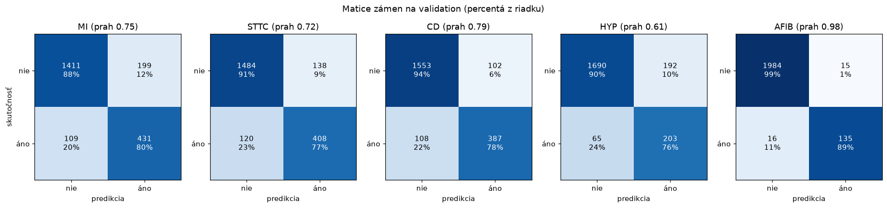

# Vyhodnotenie klasifikátora na validation (issue #18)

Kód: [`src/ekg/evaluation/clf_report.py`](../src/ekg/evaluation/clf_report.py) ·
Výsledky: [`docs/vysledky/clf_v1/hodnotenie/`](vysledky/clf_v1/hodnotenie/)

```bash
uv run ekg-clf-report            # výstupy do outputs/clf_v1/hodnotenie/
uv run ekg-clf-report --docs     # + kópia do docs/vysledky/clf_v1/hodnotenie/
```

**Čo sa hodnotí:** model `clf_v1` (#16, najlepšia epocha 20) s **uloženými prahmi z #17**. Report najprv
overí, že prahy patria k checkpointu (SHA256), inak skončí chybou. Pravdepodobnosti sa počítajú vo float32,
rovnako ako pri nastavení prahov.

**Dáta:** validation, podmnožina `classifier` – **2 150 záznamov**, z toho 910 bez žiadneho z 5 labelov
(iba NORM). Test množina sa nepoužíva (#22).

> Prahy boli zvolené na tej istej validation, preto sú metriky s prahmi (precision, recall, F1) mierne
> optimistické – krížová validácia v #17 odhaduje macro F1 o ~0,01 nižšie. AUROC a AUPRC od prahu
> nezávisia. Nezávislé vyhodnotenie bude na test množine v #22.

## Metriky po labeloch

Label je pozitívny, ak pravdepodobnosť ≥ prah. **Support** = počet záznamov s labelom (menovateľ recallu),
**neg.** = počet záznamov bez neho (menovateľ špecificity).

| label | prah | support | neg. | TP | FP | TN | FN | precision | recall | špecificita | F1 | AUROC | AUPRC |
|---|---|---|---|---|---|---|---|---|---|---|---|---|---|
| MI | 0,746 | 540 | 1 610 | 431 | 199 | 1 411 | 109 | 0,684 | 0,798 | 0,876 | 0,737 | 0,925 | 0,821 |
| STTC | 0,724 | 528 | 1 622 | 408 | 138 | 1 484 | 120 | 0,747 | 0,773 | 0,915 | 0,760 | 0,932 | 0,796 |
| CD | 0,792 | 495 | 1 655 | 387 | 102 | 1 553 | 108 | 0,791 | 0,782 | 0,938 | 0,787 | 0,933 | 0,862 |
| HYP | 0,606 | 268 | 1 882 | 203 | 192 | 1 690 | 65 | 0,514 | 0,757 | 0,898 | 0,612 | 0,907 | 0,674 |
| AFIB | 0,981 | 151 | 1 999 | 135 | 15 | 1 984 | 16 | 0,900 | 0,894 | 0,992 | 0,897 | 0,992 | 0,942 |



Matice zámen sa zhodujú s výsledkom #17 (rovnaké pravdepodobnosti, rovnaké prahy) – overuje to test.

### Nedefinované metriky

Pri `clf_v1` **nie je žiadna metrika nedefinovaná** – každý label má na validation pozitívne aj negatívne
záznamy a model každý label aspoň raz označil. Report napriek tomu pravidlá rieši (overené testami):

| metrika | nedefinovaná, ak | v reporte |
|---|---|---|
| precision | model neoznačil žiadny záznam (TP + FP = 0) | `null` + dôvod v `undefined` |
| recall | žiadny pozitívny záznam (TP + FN = 0) | `null` + dôvod |
| špecificita | žiadny negatívny záznam (TN + FP = 0) | `null` + dôvod |
| F1 | žiadny pozitívny záznam ani predikcia (2TP + FP + FN = 0) | `null` + dôvod; ak pozitívne existujú a model nič neoznačí, F1 = 0 |
| AUROC | iba jedna trieda | `null` + dôvod |
| AUPRC | žiadny pozitívny záznam | `null` + dôvod |

Macro priemer sa počíta iba z labelov, kde je metrika definovaná; počet labelov je v `report.json`
(`F1_n_labels` atď.).

## Súhrny

| | precision | recall | špecificita | F1 | AUROC | AUPRC |
|---|---|---|---|---|---|---|
| **macro** (priemer labelov) | 0,727 | 0,801 | 0,924 | **0,758** | **0,938** | 0,819 |
| **micro** (všetkých 10 750 rozhodnutí spolu) | 0,708 | 0,789 | 0,926 | 0,746 | 0,943 | 0,813 |

- Micro F1 je nižšie ako macro, lebo v micro majú väčšiu váhu časté labely MI a STTC, ktoré sú slabšie ako AFIB.
- F1 vážené supportom: 0,751.
- **Po záznamoch:** všetkých 5 rozhodnutí správne má **62,0 %** záznamov (1 334 z 2 150), aspoň jednu chybu
  816 záznamov. Hamming loss (podiel chybných rozhodnutí) 0,099.

## Analýza chýb

### Falošné poplachy – aké záznamy model označí nesprávne

| label | FP | bez labelu (NORM) | má MI | má STTC | má CD | má HYP | má AFIB |
|---|---|---|---|---|---|---|---|
| MI | 199 | 62 | – | 100 | 51 | 32 | 30 |
| STTC | 138 | 41 | 76 | – | 30 | 21 | 23 |
| CD | 102 | 29 | 57 | 28 | – | 16 | 23 |
| HYP | 192 | 49 | 62 | 74 | 66 | – | 11 |
| AFIB | 15 | 0 | 7 | 7 | 7 | 4 | – |

Väčšina falošných poplachov **nie je na zdravých záznamoch**, ale na záznamoch s inou poruchou
(napr. 137 zo 199 FP pre MI má iný label, najčastejšie STTC). Model teda zvyčajne vidí, že záznam nie je
normálny, ale zamení typ poruchy. Najčastejšia zámena je **MI ↔ STTC** – obe sa prejavujú zmenami ST úseku
a T vlny. AFIB na NORM záznamoch nedal ani jeden falošný poplach.

### Prehliadnuté – čo model povie namiesto správneho labelu

| label | FN | iba tento label | model nedal žiadny label | predikovaný MI | STTC | CD | HYP | AFIB |
|---|---|---|---|---|---|---|---|---|
| MI | 109 | 63 | 47 | – | 33 | 31 | 22 | 5 |
| STTC | 120 | 57 | 40 | 62 | – | 29 | 20 | 13 |
| CD | 108 | 44 | 44 | 36 | 30 | – | 26 | 11 |
| HYP | 65 | 19 | 20 | 26 | 14 | 26 | – | 5 |
| AFIB | 16 | 2 | 2 | 8 | 7 | 5 | 0 | – |

Tretinu až 43 % prehliadnutých záznamov (MI 47 zo 109, CD 44 zo 108, STTC 40 zo 120, HYP 20 z 65) model
označí ako úplne normálne (žiadny label). Zvyšok dostane aspoň iný label.

### Istota anotácie (likelihood SCP kódu)

PTB-XL pri diagnostických kódoch uvádza istotu kardiológa (0–100). Mapovanie labelov (#4) berie kódy bez
ohľadu na likelihood. Recall podľa najvyššej likelihood kódu, z ktorého label vznikol:

| label | likelihood 15 | 35 | 50 | 80 | 100 |
|---|---|---|---|---|---|
| MI | **0,57** (114) | 0,71 (14) | 0,78 (106) | 0,83 (23) | **0,90** (283) |
| STTC | – (1) | 0,75 (4) | 0,65 (48) | 0,86 (7) | 0,79 (455) |
| CD | – | – | 0,43 (7) | 0,67 (3) | 0,79 (485) |
| HYP | 0,72 (32) | 0,70 (20) | 0,73 (74) | 0,75 (8) | 0,79 (134) |

(v zátvorke počet záznamov; STTC má navyše 13 záznamov s likelihood 0, recall 0,69; AFIB je rytmický kód
a likelihood takmer nepoužíva – 148 zo 151 má 0)

**MI s likelihood 15 tvorí 45 % prehliadnutých MI** (49 zo 109). Ide o nálezy typu „infarkt nie je
vylúčený“ – tri najistejšie prehliadnuté MI (ecg_id 11671, 14202, 14110) majú jediný MI kód s likelihood 15,
napr. 11671 a 14110 majú v texte nálezu „septaler Infarkt nicht auszuschliessen“. Pri istých MI (100) je recall 0,90. Časť chýb je teda
neistota v samotnej anotácii, nie iba chyba modelu. Naopak, najistejšie falošné MI sú NORM záznamy
s hraničnými nálezmi (napr. „poor progression of R waves“, abnormné QRS).

### Podtriedy PTB-XL

| label | dobre zachytené | slabo zachytené |
|---|---|---|
| MI | AMI 0,84 (306), IMI 0,84 (326) | **LMI 0,30** (20) |
| STTC | ISC_ 0,91 (125), ISCA 0,80 (92) | STTC 0,70 (225), ISCI 0,72 (39) |
| CD | CLBBB 1,00 (54), CRBBB 1,00 (55), LAFB/LPFB 0,89 (181) | **IVCD 0,51** (78), WPW 0,57 (7), _AVB 0,72 (83) |
| HYP | LVH 0,83 (210) | **LAO/LAE 0,49** (43), RAO/RAE 0,50 (10), RVH 0,67 (12) |

Výrazné poruchy (blokády ramienok, hypertrofia ľavej komory) model rozpoznáva takmer vždy. Slabšie sú
nešpecifické poruchy vedenia (IVCD), laterálny infarkt (LMI) a zväčšenie predsiení (LAO/LAE), ktoré sa
prejavujú hlavne na P vlne – tá je pri 100 Hz zachytená iba niekoľkými vzorkami. Celá tabuľka:
[`podtriedy.csv`](vysledky/clf_v1/hodnotenie/podtriedy.csv).

### Podľa počtu labelov, pohlavia, veku a šumu

| počet skutočných labelov | záznamov | bez chyby | priemerne predikovaných labelov |
|---|---|---|---|
| 0 (NORM) | 910 | 82,1 % | 0,20 |
| 1 | 699 | 50,9 % | 1,11 |
| 2 | 379 | 42,7 % | 2,00 |
| 3 | 125 | 39,2 % | 2,90 |
| 4–5 | 37 | 54,1 % | 3,68 |

18 % NORM záznamov dostane aspoň jeden falošný label. Počet predikovaných labelov dobre sleduje skutočný počet.

| skupina | záznamov | micro F1 | micro recall | micro špecificita |
|---|---|---|---|---|
| muži | 1 116 | 0,744 | 0,791 | 0,922 |
| ženy | 1 034 | 0,749 | 0,787 | 0,931 |
| vek < 40 | 284 | 0,700 | 0,747 | 0,978 |
| vek 40–59 | 664 | **0,664** | **0,662** | 0,961 |
| vek 60–79 | 919 | 0,744 | 0,796 | 0,899 |
| vek ≥ 80 | 283 | 0,810 | 0,868 | 0,844 |
| bez šumu v anotácii | 1 788 | 0,751 | 0,793 | 0,928 |
| šum v anotácii (static/burst noise, elektródy) | 362 | 0,721 | 0,769 | 0,921 |

- **Pohlavie:** bez rozdielu.
- **Vek:** u starších model zachytí viac porúch, ale dáva aj viac falošných poplachov. Recall v skupine 40–59
  je nižší pri MI, STTC, CD aj HYP (0,65 – 0,67; pri ≥ 80 je 0,82 – 0,90). Vysvetlenie som neoveril –
  možné je, že u mladších sú poruchy menej výrazné, alebo model čiastočne využíva znaky súvisiace s vekom.
- **Šum:** záznamy so šumom sú o niečo horšie (F1 0,72 vs. 0,75), rozdiel je malý.

### Najistejšie chyby

[`najvacsie_chyby.csv`](vysledky/clf_v1/hodnotenie/najvacsie_chyby.csv) – pre každý label 10 falošných
poplachov s najvyššou a 10 prehliadnutých s najnižšou pravdepodobnosťou (ecg_id, skutočné a predikované
labely). Slúži na ručnú kontrolu a výber príkladov pre Grad-CAM (#27).

## Zhrnutie

- Macro AUROC **0,938**, macro F1 **0,758** s prahmi z #17; najlepší je AFIB (F1 0,90), najslabší HYP (F1 0,61,
  každé druhé označenie HYP je falošné).
- Chyby sú najmä **zámeny medzi poruchami** (MI ↔ STTC), nie poplachy na zdravých záznamoch.
- Značná časť prehliadnutých MI sú **neisté anotácie** (likelihood 15). Pri istých MI je recall 0,90.
- Slabé miesta: zväčšenie predsiení (P vlna), IVCD, laterálny infarkt, vek 40–59.

## Výstupy

| súbor | obsah |
|---|---|
| [`report.json`](vysledky/clf_v1/hodnotenie/report.json) | prahy, support, matice zámen, metriky, nedefinované metriky s dôvodom, macro/micro, po záznamoch, SHA256 checkpointu |
| [`metriky_po_labeloch.csv`](vysledky/clf_v1/hodnotenie/metriky_po_labeloch.csv) | tabuľka metrík po labeloch |
| [`falosne_poplachy.csv`](vysledky/clf_v1/hodnotenie/falosne_poplachy.csv), [`prehliadnute.csv`](vysledky/clf_v1/hodnotenie/prehliadnute.csv) | zloženie FP a FN |
| [`podla_istoty_anotacie.csv`](vysledky/clf_v1/hodnotenie/podla_istoty_anotacie.csv), [`podtriedy.csv`](vysledky/clf_v1/hodnotenie/podtriedy.csv) | recall podľa likelihood a podtried |
| [`podla_poctu_labelov.csv`](vysledky/clf_v1/hodnotenie/podla_poctu_labelov.csv), [`podla_skupin.csv`](vysledky/clf_v1/hodnotenie/podla_skupin.csv) | chyby podľa skupín |
| [`najvacsie_chyby.csv`](vysledky/clf_v1/hodnotenie/najvacsie_chyby.csv) | najistejšie chyby |

## Overenie (testy)

`tests/test_clf_report.py` – 13 testov: precision, recall, F1 a macro/micro/vážené F1 sa zhodujú so
scikit-learn, prah vrátane rovnosti, nedefinované metriky majú `null` a dôvod, macro vynechá nedefinované
labely, zloženie FP a FN na ručnom príklade, skupiny pokrývajú všetky záznamy (vek 300 = ≥ 80), recall
podtried a likelihood, poradie najväčších chýb, CLI zapíše všetky výstupy a odmietne prahy iného
checkpointu, uložený report sa zhoduje s maticami zámen z #17.
