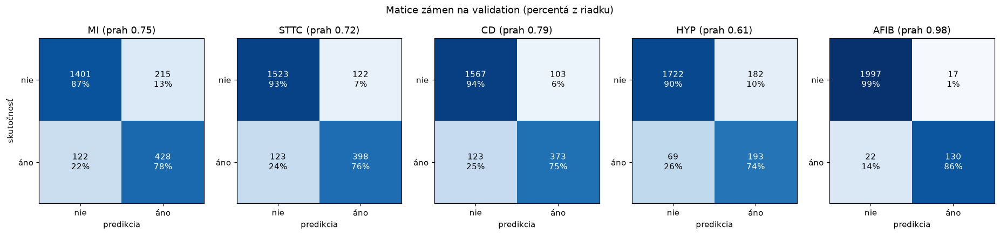

# Záverečné vyhodnotenie na test množine (issue #22)

Kód: [`src/ekg/evaluation/final_evaluation.py`](../src/ekg/evaluation/final_evaluation.py) ·
Výsledky: [`docs/vysledky/test/`](vysledky/test/)

```bash
uv run ekg-final-eval --check     # overí, že modely, prahy, dáta a kód sú stále zmrazené
uv run ekg-final-eval             # vyhodnotenie (už prebehlo – výsledky sa neprepisujú)
```

Toto je jediné miesto v projekte, kde sa modely spustili na **test množine** (fold 10 PTB-XL,
anotácie overené človekom). Všetky rozhodnutia – architektúry, tréning, výber epochy, prah anomálie,
prahy labelov, pravidlo súladu – padli predtým na train a validation.

## Postup (doložený históriou gitu)

| krok | čo | dôkaz |
|---|---|---|
| 1 | vyhodnocovací kód + testy; **skúška nanečisto na validation** (test sa nepoužil) dala presne čísla z #14 a #18 | denník |
| 2 | **zmrazenie**: SHA256 44 súborov – checkpointy `ae_v1` a `clf_v1`, prah anomálie, prahy labelov, parametre preprocessingu, manifest rozdelenia, mapovanie labelov, `uv.lock` a celý kód `src/ekg` + verzie | [`zmrazenie.json`](vysledky/test/zmrazenie.json), commit `a96600e` **pred** vyhodnotením |
| 3 | vyhodnotenie **raz**: najprv overí, že sa od zmrazenia nezmenil ani jeden súbor, potom spustí zmrazenú pipeline (#19) na všetkých test záznamoch | [`report.json`](vysledky/test/report.json): `freeze_sha256`, `freeze_check: OK`, `git_commit` |

- Hash `a96600e` (a `git_commit` v reporte) je commit vo vetve
  [PR #54](https://github.com/SPSE-Zochova-2627-4c/Nosko_EKG-classification/pull/54) – tam je vidieť
  poradie „zmrazenie → výsledky“. Merge cez rebase vytvorí na `main` rovnaké commity s inými hashmi;
  obsah zmrazenia overí kedykoľvek `uv run ekg-final-eval --check`.
- Vyhodnotenie **existujúce výsledky neprepíše** a pri akejkoľvek zmene modelu, prahu, dát alebo kódu
  sa odmietne spustiť (testy).
- Test množinu v kóde otvára iba záverečné vyhodnotenie a technická kontrola dát z #9, ktorá nespúšťa
  žiadny model (test to kontroluje v zdrojovom kóde).
- **Po pohľade na výsledky sa nič neladilo.** Všetky čísla nižšie sú z jediného behu.

## Dáta

| | záznamov | pacientov | poznámka |
|---|---|---|---|
| celá test množina | **2 198** | 1 904 | všetky záznamy foldu 10, nič sa nevynechalo |
| Model B (podmnožina `classifier`) | 2 166 | | záznamy s diagnostickým kódom alebo AFIB (#4) |
| Model A – referenčný cieľ | 464 prísny NORM + 1 257 s patológiou | | 477 ostatných mimo metrík, rovnako ako na validation (#13) |

**Prekrývanie pacientov s train aj val: 0** (overené pri vyhodnotení, uložené v reporte).

Intervaly v zátvorkách sú **95 % bootstrap po pacientoch** (1 000×; prevzorkujú sa celí pacienti,
lebo ich záznamy nie sú nezávislé).

## Model A – autoencoder (detekcia anomálií)

Prah 0,0384 z validation (#13), prísny NORM vs. záznam s aspoň jednou z 5 porúch.

| metrika | validation (#14) | **test** |
|---|---|---|
| AUROC | 0,832 | **0,796** (0,771 – 0,820) |
| AUPRC | 0,933 | 0,914 |
| senzitivita | 0,612 | **0,586** (0,557 – 0,614) |
| špecificita | 0,910 | **0,858** (0,824 – 0,889) |
| precision | 0,949 | 0,918 |
| F1 | 0,744 | 0,716 |
| matica zámen | TP 759, FP 41, TN 413, FN 481 | TP 737, FP 66, TN 398, FN 520 |

Podiel záznamov označených ako anomália podľa labelu ([`ae_detekcia_podla_labelu.csv`](vysledky/test/ae_detekcia_podla_labelu.csv)):
MI 63 %, STTC 59 %, CD 70 %, HYP 79 %, AFIB 81 %, 2 a viac labelov 78 %.

## Model B – klasifikátor (5 porúch)

Prahy z validation (#17).

| label | support | precision | recall | špecificita | F1 (95 % CI) | AUROC (95 % CI) | AUPRC |
|---|---|---|---|---|---|---|---|
| MI | 550 | 0,666 | 0,778 | 0,867 | 0,718 (0,688 – 0,749) | 0,910 (0,895 – 0,923) | 0,798 |
| STTC | 521 | 0,765 | 0,764 | 0,926 | 0,765 (0,734 – 0,792) | 0,933 (0,921 – 0,945) | 0,823 |
| CD | 496 | 0,784 | 0,752 | 0,938 | 0,767 (0,736 – 0,798) | 0,917 (0,900 – 0,933) | 0,834 |
| HYP | 262 | 0,515 | 0,737 | 0,904 | 0,606 (0,561 – 0,648) | 0,903 (0,883 – 0,921) | 0,668 |
| AFIB | 152 | 0,884 | 0,855 | 0,992 | 0,870 (0,824 – 0,909) | 0,981 (0,966 – 0,993) | 0,915 |
| **macro** | | 0,723 | 0,777 | 0,925 | **0,745** (0,728 – 0,762) | **0,929** (0,922 – 0,936) | 0,808 |
| **micro** | | 0,704 | 0,768 | 0,928 | 0,735 | 0,936 | 0,800 |



- **Žiadna metrika nie je nedefinovaná** – každý label má v teste pozitívne aj negatívne záznamy
  a model každý aspoň raz označil.
- Všetkých 5 rozhodnutí správne má 60,8 % záznamov (validation 62,0 %), Hamming loss 0,101.

### Porovnanie s validation

| | validation (#18) | test | rozdiel |
|---|---|---|---|
| macro AUROC | 0,938 | 0,929 | −0,009 |
| macro F1 | 0,758 | 0,745 | −0,013 |
| macro recall | 0,801 | 0,777 | −0,024 |
| macro precision | 0,727 | 0,723 | −0,005 |

Celá tabuľka po labeloch: [`porovnanie_val_test.csv`](vysledky/test/porovnanie_val_test.csv).

## Súlad modelov (#19)

| prípad | test | z toho so skutočnou poruchou | validation |
|---|---|---|---|
| súlad | 1 509 (70 %) | 818 | 1 525 (71 %) |
| A v norme, B porucha | 488 (23 %) | 398 | 490 (23 %) |
| A anomália, B nič | 169 (8 %) | 41 | 135 (6 %) |

## Analýza chýb (test)

Potvrdzujú sa zistenia z validation (#18):

- **Chyby klasifikátora sú najmä zámeny medzi poruchami.** Zo 215 falošných MI má 160 inú poruchu,
  najčastejšie STTC (111) ([`clf_falosne_poplachy.csv`](vysledky/test/clf_falosne_poplachy.csv)).
- **Neisté anotácie:** recall MI 0,58 pri likelihood 15 (117 záznamov) vs. 0,89 pri likelihood 100
  (268) – rovnaký vzor ako na validation (0,57 vs. 0,90)
  ([`clf_podla_istoty_anotacie.csv`](vysledky/test/clf_podla_istoty_anotacie.csv)).
- **Slabé podtriedy:** IVCD 0,38 (79), LMI 0,45 (20), LAO/LAE 0,48 (42), RVH 0,25 (12, malý počet);
  blokády ramienok CLBBB a CRBBB 100 %, LVH 0,83 ([`clf_podtriedy.csv`](vysledky/test/clf_podtriedy.csv)).
- **Vek:** recall rastie s vekom – < 40 rokov 0,55, 40–59 0,70, 60–79 0,78, ≥ 80 0,83; špecificita naopak
  klesá (0,99 → 0,85). Na validation bol najslabší vek 40–59 ([`clf_podla_skupin.csv`](vysledky/test/clf_podla_skupin.csv)).
- **Pohlavie:** micro F1 muži 0,751, ženy 0,719. Na validation rozdiel nebol (0,744 vs. 0,749) –
  bez intervalov spoľahlivosti to beriem iba ako pozorovanie, nie ako preukázaný rozdiel (podrobnejšie #26).

## Čo z toho vyplýva

1. **Klasifikátor zovšeobecňuje.** Macro AUROC 0,929 je len o 0,009 nižšie ako na validation.
   Macro F1 0,745 zodpovedá odhadu z krížovej validácie pri výbere prahov v #17 (0,748) – **prahy
   zvolené na validation fungujú aj na nových dátach** a optimizmus validation bol odhadnutý správne.
2. **Autoencoder je na teste slabší, než ukázala validation.** AUROC 0,796 je pod 95 % intervalom
   na validation (0,812 – 0,852) a falošné poplachy na prísnom NORM stúpli zo 41 na 66 (špecificita
   0,910 → 0,858). Validation sa pri autoencoderi použila na výber epochy aj prahu, takže bola mierne
   optimistická; časť rozdielu môže byť aj náhodná variabilita medzi foldmi. Podľa pravidiel #22 som
   prah ani model **neupravoval**.
3. **Porovnanie s literatúrou:** benchmark Strodthoff et al. (2020) uvádza pre superdiagnostické triedy
   PTB-XL (NORM, MI, STTC, CD, HYP) na rovnakom test folde macro AUROC ~0,93. Náš klasifikátor má
   0,929 (0,922 – 0,936) – na porovnateľnej úrovni. Labely nie sú rovnaké (namiesto NORM máme AFIB),
   preto ide iba o orientačné porovnanie.
4. **Silné a slabé stránky systému** sú na teste rovnaké ako na validation: AFIB a blokády ramienok
   výborne, HYP (precision 0,52) a nešpecifické poruchy vedenia slabo, autoencoder prehliada približne
   40 % patológií.

## Zmeny po teste

Pri príprave dema (#23) sa ukázala chyba: `ekg-predict` so súborom (napr. `examples/00127_lr`) bez
stiahnutého datasetu padal, lebo načítaval databázu PTB-XL aj vtedy, keď žiadny záznam z nej nebol zadaný.
Oprava je jedna podmienka v `src/ekg/inference.py` – teda zmena zmrazeného kódu.

Aby zmrazenie ostalo dôveryhodné, zmeny po teste sa **evidujú** v
[`zmeny_po_teste.json`](vysledky/test/zmeny_po_teste.json) (pôvodný a nový SHA256, dôvod, overenie):

- povolené sú **iba zmeny kódu v `src/`**, ktoré sú zapísané presne (pôvodný SHA256 = zmrazený,
  nový = súčasný); akákoľvek ďalšia, nezapísaná zmena je pri `--check` chyba,
- **modely, prahy, dáta, manifesty a `uv.lock` sa po teste meniť nesmú vôbec** – ani so záznamom,
- `uv run ekg-final-eval --check` vypíše „Zmrazenie sedí.“ a pod tým každú zapísanú zmenu.

| súbor | zmena | vplyv na výsledky |
|---|---|---|
| `src/ekg/inference.py` | `ptbxl_records([])` nenačíta databázu (2 riadky) | žiadny – výstupy pre záznamy 10, 17, 127, 352 sú zhodné s #19 |
| `src/ekg/evaluation/final_evaluation.py` | `--check` prijme zapísané zmeny kódu | žiadny – výpočet metrík sa nezmenil |

Výsledky tohto dokumentu pochádzajú z behu so zmrazeným kódom (commit `a96600e`).

## Uložené výstupy (`docs/vysledky/test/`)

| súbor | obsah |
|---|---|
| `zmrazenie.json` | SHA256 a verzie všetkého, od čoho výsledok závisí |
| `report.json` | počty, únik pacientov, verzie modelov, všetky metriky oboch modelov s bootstrap intervalmi, súlad modelov |
| `predikcie_test.csv` | **predikcie pre všetkých 2 198 záznamov** v exportnom formáte (#21, schéma 1.2) – dajú sa načítať `export.load_csv()`; JSON verzia v `outputs/test/` |
| `porovnanie_val_test.csv` | validation vs. test pre každú metriku |
| `ae_*.csv`, `clf_*.csv`, `clf_matice_zamen.png` | analýza chýb oboch modelov |

## Overenie (testy)

`tests/test_final_evaluation.py` – 15 testov: zmrazenie pokrýva modely, prahy, dáta aj kód; akákoľvek
zmena po zmrazení (prah, kód, nový súbor, chýbajúci manifest) zastaví vyhodnotenie; výsledky sa
neprepíšu; únik pacientov sa zistí; bootstrap prevzorkúva celých pacientov a je reprodukovateľný;
metriky sú totožné s vyhodnotením na validation (#14, #18); test množinu otvára iba záverečné
vyhodnotenie (+ kontrola dát bez modelov); **uložený report patrí k zmrazeniu** a **z uložených
predikcií sa dajú prepočítať matice zámen reportu**.
