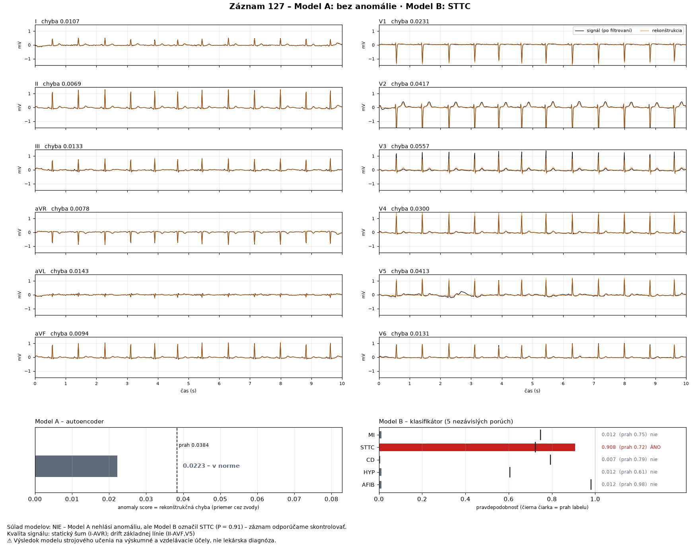
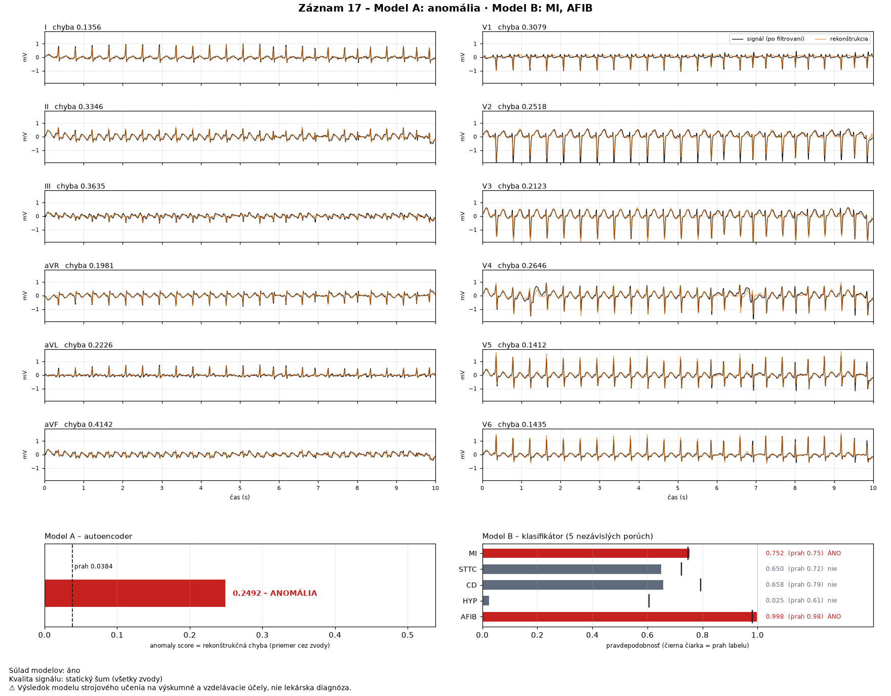

# Zobrazenie EKG, rekonštrukcie a výsledkov (issue #20)

Kód: [`src/ekg/visualization.py`](../src/ekg/visualization.py) (obrázok),
[`streamlit_app.py`](../streamlit_app.py) (web aplikácia),
[`src/ekg/app_support.py`](../src/ekg/app_support.py) (načítanie nahraných súborov, tabuľky)

```bash
uv run streamlit run streamlit_app.py           # web aplikácia → http://localhost:8501
uv run ekg-show --ecg-id 127                     # obrázok do outputs/zobrazenie/zaznam_127.png
uv run ekg-show cesta/k/zaznamu -o prehlad.png   # vlastný WFDB záznam
```

Zobrazenie spĺňa časť maturitného zadania **„výstup zobrazí anomaly score a pravdepodobnosť jednotlivých
porúch“**. Všetky hodnoty pochádzajú priamo z výstupu pipeline (#19) – obrázok ani aplikácia nič
neprepočítavajú, takže sa nemôžu od pipeline líšiť (overuje test).

## Obrázok (`ekg-show`, rovnaký aj v aplikácii)



| časť | čo ukazuje |
|---|---|
| 12 zvodov | končatinové I, II, III, aVR, aVL, aVF vľavo, hrudné V1–V6 vpravo (ako na bežnom zázname); časová os **0–10 s**, amplitúda v **mV**, spoločná mierka pre všetky zvody |
| čierna čiara | signál po filtrovaní (hornopriepustný filter 0,5 Hz z preprocessingu #8) |
| oranžová čiara | **rekonštrukcia autoencodera**, prevedená späť do mV (dá sa vypnúť) |
| nadpis zvodu | rekonštrukčná chyba daného zvodu |
| Model A | anomaly score (stĺpec), prah (prerušovaná čiara), výsledok „ANOMÁLIA“ / „v norme“ |
| Model B | pravdepodobnosť každej z 5 porúch, prah labelu (čierna čiarka), výsledok „ÁNO“ / „nie“; pozitívne červené |
| spodný text | súlad modelov (pri nesúlade vysvetlenie), kvalita signálu, upozornenie, že nejde o diagnózu |

**Prečo signál po filtrovaní a nie surový:** autoencoder dostáva signál po filtrovaní a normalizácii
a rekonštruuje ho. Porovnať sa dá iba s tým, čo naozaj dostal – surový signál má posun základnej línie,
ktorý autoencoder nevidí. Normalizácia sa na zobrazenie vráti späť (x · std + mean), takže oba priebehy
sú v mV. Chyba sa počíta v normalizovanom priestore, presne ako anomaly score – test overuje, že
z nakreslenej rekonštrukcie vyjde rovnaká chyba po zvodoch aj rovnaké anomaly score.



Záznam 17 (AFIB): nepravidelné rozostupy QRS komplexov sú dobre viditeľné; autoencoder ich rekonštruuje
horšie (anomaly score 0,249, 6,5× nad prahom), klasifikátor označí AFIB s P = 0,998. MI s P = 0,752 tesne
prekročí prah 0,746, hoci záznam MI nemá – príklad falošne pozitívneho labelu.

## Web aplikácia (`streamlit_app.py`)

- **Zdroj záznamu:**
  - *PTB-XL* – 4 ukážkové záznamy z validation (každý prípad pravidla súladu z #19) alebo ľubovoľné `ecg_id`;
    záznamy **test množiny sú zamknuté** (#22) a aplikácia ich odmietne s vysvetlením,
  - *Vlastný súbor* – WFDB záznam (`.hea` + `.dat`, 100 Hz, 12 zvodov, 10 s) alebo NumPy `.npy` (12 × 1000 v mV).
- **Výsledky:** anomaly score, prah, výsledok Modelu A a B, súlad modelov; upozornenie pri nesúlade
  a pri probléme s kvalitou; tabuľka 5 porúch (pravdepodobnosť ako pruh, prah, výsledok); tabuľka chýb
  po zvodoch; obrázok vyššie s prepínačom rekonštrukcie.
- **Stiahnutie:** výsledok v JSON a CSV (formát z #21, schéma 1.2) a obrázok PNG.
- **Upozornenie** „Nejde o lekársku diagnózu“ je hneď pod nadpisom, ešte pred výberom záznamu,
  a znova na obrázku.
- Modely sa načítajú raz (`st.cache_resource`), výsledky posledných záznamov sa pamätajú (`st.cache_data`).
- Svetlá téma (`.streamlit/config.toml`) – obrázok z matplotlibu má biele pozadie, v tmavej téme by bol
  biely blok. Odosielanie anonymných štatistík Streamlitu je vypnuté.

### Neplatný vstup

Aplikácia aj `ekg-show` použijú kontrolu vstupu z kontraktu (#2) a analýzu **nespustia**; zobrazí sa
chyba s dôvodom:

| situácia | správa (skrátene) |
|---|---|
| nahraný súbor iného typu | „Nepodporovaný typ súboru … očakáva sa .hea + .dat alebo .npy“ |
| chýba `.dat` k `.hea` alebo majú iné mená | „WFDB záznam potrebuje práve jeden súbor .hea a jeden .dat“ / „musia mať rovnaké meno“ |
| `.npy` otočené (1000, 12) | „Záznam je vo formáte WFDB (1000, 12) – použi from_wfdb()“ |
| iná dĺžka, iná frekvencia, NaN | „Tvar signálu …“ / „Vzorkovacia frekvencia … nie je podporovaná“ / „NaN … v zvodoch“ |
| záznam z test množiny | „Záznamy [9] patria do test množiny, ktorá je zamknutá pre #22.“ |
| chýbajú modely | „Chýba súbor … Stiahni model z GitHub Release …“ |

## Závislosť: Streamlit a pyarrow

Pribudla knižnica `streamlit` (1.67). Jej tabuľky potrebujú `pyarrow`, ktorého najnovšia verzia 26
**nepodporuje NumPy 1.x** – a projekt má v lock súbore NumPy 1.26 kvôli Intel Macu (torch 2.2.2).
Prvé spustenie aplikácie preto spadlo pri tabuľke („pyarrow requires NumPy 2.0“). Riešenie:
`pyarrow<26` (verzia 25 s NumPy 1.26 funguje). Prechod na NumPy 2 na Linuxe som zamietol – zmenil by
prostredie, v ktorom sú natrénované a kalibrované modely.

## Overenie

- **Testy** `tests/test_visualization.py` (21): rekonštrukcia dáva presne chybu a anomaly score
  z pipeline, obrázok má 12 pomenovaných zvodov s osou 0–10 s, signál aj rekonštrukciu, texty
  zodpovedajú výsledku (score, prahy, pravdepodobnosti, upozornenie), načítanie `.npy` aj WFDB,
  7 druhov neplatného nahratého súboru, ukážkové záznamy sú z validation, `ekg-show` vytvorí PNG
  a odmietne test množinu; **test celej aplikácie** (`streamlit.testing.v1.AppTest`): hodnoty
  v aplikácii sa zhodujú s pipeline, nesúlad pri zázname 127, zamknutý záznam 9, režim nahrávania.
- **Spustená aplikácia** (headless + agent API Streamlitu a prehliadač): všetky prvky sa zobrazia,
  prepínač rekonštrukcie funguje, v logu servera žiadne varovania.
